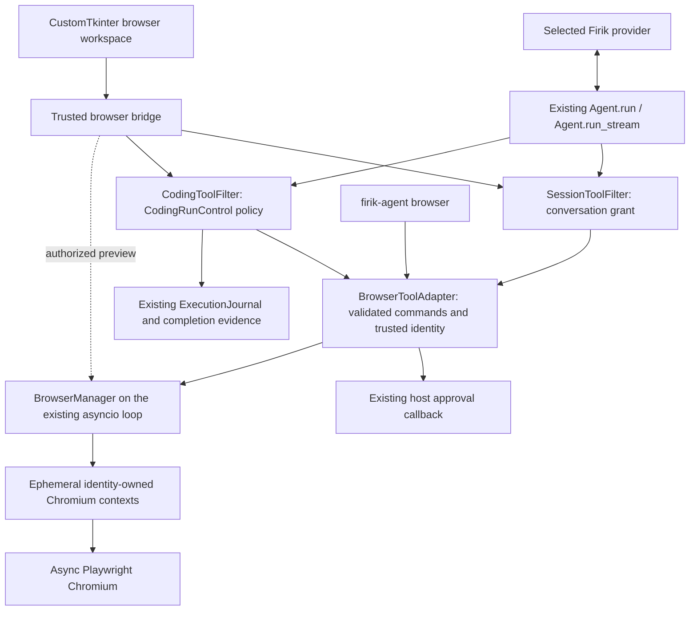

# Native Browser architecture

This document describes the implemented Python/CustomTkinter browser. The
[hybrid desktop architecture plan](HYBRID_DESKTOP_ARCHITECTURE.md) defines the
proposed Electron/React/TypeScript migration, including the distinction between
a Playwright page preview and a real embedded WebContentsView. The
[first hybrid desktop slice](HYBRID_DESKTOP_MIGRATION.md) implements chat and
the shared backend boundary; the browser remains Python-owned at this stage.

The browser is an optional host tool executor for Firik's existing native agent.
It does not call a provider, run a second reasoning loop, replace a harness, or
grant execution authority through MCP selection.



## Discovery and baseline

Implementation started from clean `main` at
`2c184cacf713b2e7fac3adbf848ab07919b48bf6` on 6 November 2026.
The checkout reported version 0.2.46. The available repository environment used
Python 3.13.2; the default system interpreter reported 3.15.2. The project still
supports Python 3.10+. No user modifications were reset, stashed or overwritten.

The provider/recovery baseline before edits was:

```sh
.venv/bin/python -m pytest -q tests/test_provider_failures.py tests/test_agent_loop.py tests/test_reasoning_effort.py tests/test_durable_execution.py
# 153 passed in 2.32s
```

`AsyncRuntime` owns the desktop's persistent loop. Normal chat uses
`SessionToolFilter`, whereas coding owns an isolated `_CodingRegistry`, a
`CodingToolFilter` and `CodingRunControl`. Browser definitions use
`source="native:browser"` and `execution_boundary="host"`; they are absent from
the unrestricted global builtin registry. MCP's desktop connection manager and
legacy manager remain separate. Web MCP continues to provide static page reads
and public search. No browser MCP facade is registered because that transport
does not supply authenticated host conversation/project/actor identity.

## Authority and lifecycle

The host constructs `BrowserIdentity` and obtains current `BrowserGrant` values.
Models cannot set conversation, project, run or actor identity, add origins,
select a browser executable, approve an operation, or resume a manual handoff.
An opaque tab identifier grants no authority: ownership is checked again by the
manager. Contexts are ephemeral, and unrelated owners do not share cookies or
authentication state. Per-page asynchronous locking serializes observations
and mutations against the same page.

Normal chat also narrows unrelated tool authority after Browser activation or
any retained browser tool result. `SessionToolFilter` requires an exact trusted
host approval for unrelated filesystem, shell, plugin, meta and MCP calls.
Firik's builtin public Web search/reader is the narrow exception: its captured
connection/client/server/definition/handler identity is checked at admission and
dispatch, and it enforces public HTTPS/private-address policy at each fetch and
redirect. Remote tools cannot assert this provenance. Explicit Web MCP confirmation
and deny policies still apply. Without a trusted approval callback, unrelated tools
are hidden and denied.
Approvals bind to a copied canonical argument object and the current registry,
definition and handler; policy revocation or replacement invalidates approval.
This restriction survives Browser disablement, history restoration and
compaction through runtime-owned chat metadata. An explicit full history clear
resets it when Browser is disabled. Page text cannot convert selected tool
names or global builtin registration into permission to access local data.

The tool adapter validates Pydantic schemas before manager dispatch. Interaction
commands obtain an exact prepared preview and fingerprint from current page
state, request host approval, recheck the live grant and revalidate before the
manager dispatches the approved command. A click or Enter can submit a form and
therefore retains a consequential-action approval boundary. Manual handoff
blocks automation until a trusted host resumes and obtains fresh observations.

The existing agent journals a tool intent before dispatch and preserves unknown
effects after interruption. Explicit browser reads are classified as state
inspection only for `native:browser` definitions. Navigation and interactions
are external effects; unfamiliar browser operations have unknown semantics.
Neither timeouts nor cancellation prove that a website did not receive an
operation. Recovery does not automatically replay an uncertain mutation.
Desktop shutdown awaits cleanup for every distinct coding executor, including
its supervised development server, before closing shared Chromium. Cleanup
attempts continue after individual failures and retain reconciliation metadata;
the runtime wait is bounded rather than reporting unconfirmed closure as success.
The coding-only `browser_verify` observation records actual assertion results
against the current source digest through existing verification evidence; it
does not declare task completion or replace quality gates.

## Network boundary

Desktop grants admit public HTTPS sites without an origin allowlist. CLI grants
can retain exact-origin restrictions. Public HTTP is rejected; explicitly granted
local development origins are the HTTP exception. Private origins still require
an exact host grant. The service rejects embedded credentials and unsupported URL schemes.
Policy applies to navigation and intercepted subordinate requests, rather than
only validating the first URL. Service workers and WebSockets are restricted by
the driver. Downloads, arbitrary model-selected uploads, unrestricted script
evaluation, CDP and persistent profiles are outside the admitted core surface.

These controls are application policy on a host browser. DNS is checked by the
host and resolved separately by Chromium; a DNS race and browser networking
outside interception are not OS-contained. Request routing is **not a firewall**.
`strict_network_isolation=true` is rejected until a separately verified egress
boundary exists. Docker command isolation does not change the browser's host
execution boundary.
Redirect handling validates the destination and current live grant at each hop,
with a bounded chain and no automatic replay of uncertain submissions.
Top-level redirects perform a fresh browser navigation; POST 302/303 responses
continue with GET, while mutation-preserving redirects remain blocked. Cross-origin
subresource redirects are blocked rather than fulfilled under a misleading source
origin. This preserves the authorization/CORS boundary. WebSocket-dependent apps,
cross-origin resource redirects and service-worker workflows may still need
capabilities beyond this core implementation.

## Observations, images and provider compatibility

DOM/ARIA observations are the default. Observations carry revision information;
interaction targets must be current, unique, visible and enabled. Page text,
ARIA labels, console entries and network diagnostics remain untrusted data.
They cannot authorize file access, expand browser grants or approve tools.

Screenshots use private bounded temporary artifacts rather than base64 journal
payloads. UI preview, evidence storage and model delivery are distinct choices.
The native browser tool adapter currently supplies artifact references and does
not attach model image parts.
Typed fill/type values are omitted from tool-event and stored history copies.
The native loop keeps a separate executable call so this privacy projection
does not change legitimate form entry. Password/MFA/payment targets and forms
require manual control; screenshot input masks also cover child frames.

The chat Browser panel shares its existing page context with the agent and runs
Chromium headlessly. It renders in-memory page frames alongside the chat. Host-only
input and navigation methods serialize against the same page locks, verify the
current identity/grant and require manual ownership for raw input. They are never
model tool definitions. The host can view a masked preview during manual control;
agent observations and captures remain blocked until explicit host resume.

The provider serializer has a tested optional browser image path. It requires
all of: explicit trusted model metadata `supports_vision=true`, an independently
host-set `provider.browser_image_transport_verified=true`, and per-observation
`browser_model_image=true` host metadata. Every default is off or unknown.
Browser tool messages remain text; permitted image observations become user
image input **after all tool results in the batch**, preserving the provider
protocol. Existing unrelated image tool serialization remains unchanged.
Mock HTTP tests inspect the complete outbound Firik and OpenAI-compatible JSON,
including streaming. They do not establish endpoint acceptance, vision quality
or successful live Evren inference. No provider quota is consumed by these tests.
An explicit trusted `supports_tools=false` declaration removes tool schemas and
rejects unexpected tool calls in both ordinary chat and coding. Unknown tool
capability remains unknown rather than being inferred from the model name.

## Packaging and validation boundary

Playwright is optional. Its package and matching Chromium installation are
explicit user operations; starting Firik never downloads a browser. The initial
version range targets Playwright 1.64.1, whose Python API includes native
`get_by_ref`; older ARIA snapshot availability alone is insufficient evidence of
that API. Sources: [PyPI package metadata](https://pypi.org/project/playwright/),
[official reference API](https://playwright.dev/python/docs/api/class-page#page-get-by-ref),
[request-routing limitations](https://playwright.dev/python/docs/api/class-browsercontext#browser-context-route).

Browser unit tests run without Chromium. Separately marked tests require a real
installed browser. Cross-platform source support, mocked tests and PyInstaller
hook changes do not establish a built, signed or packaged macOS/Windows/Linux
application. Consult the final execution report for the exact tests and real
Chromium evidence available for this checkout.
