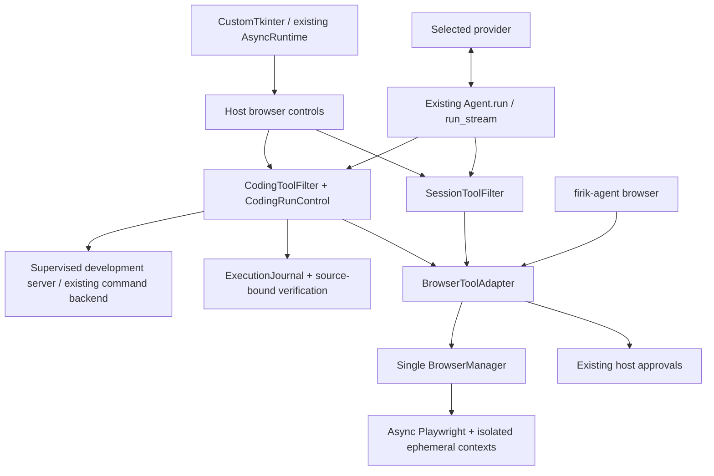

# Native Browser implementation and verification

The 7 November follow-up replaces the desktop's separate browser window and
domain-list workflow: see [inline browser verification](BROWSER_INLINE_VERIFICATION_20261107.md).

Date: 6 November 2026. Starting checkout: clean `main`, commit
`2c184cacf713b2e7fac3adbf848ab07919b48bf6`, application version 0.2.46.
Changes are in the working tree; this task does not publish a release.

## Result and boundaries

Firik's existing native harness controls real Chromium through validated browser
tools. The implementation preserves the selected provider, run-local coding
registry, session ownership, host approvals, execution journal and completion
gate. There is no second model loop or required external browser MCP server.

The verified platform is macOS Apple Silicon, Python 3.13.2, Playwright 1.64.1,
Chromium 156.0.8078.4. Python 3.10+, Intel macOS, native Windows/Linux and public
application distribution require their own execution evidence. A real local
macOS arm64 frozen build, native UI smoke and Chromium launch are verified below;
that does not establish the remaining platform or public distribution results.

Browser execution uses host privileges. Exact-origin admission, private-origin
grants, request routing, blocked service workers/WebSockets and fresh DNS checks
are application controls. They do not provide OS network containment or prevent
every DNS race. Strict network-isolation mode fails closed. Docker command
isolation does not cover this host browser.

## Architecture and changed areas



New source packages/components:

- `firik_agent/browser`: configuration, identities/grants, security, one browser
  manager, ephemeral artifacts, validated tool adapter and CLI.
- `firik_agent/ui/browser_bridge.py` and `components/browser_preview.py`: shared
  service access, scoped controls, native PNG preview, host resume and Stop.
- `firik_agent/projects/dev_servers.py`: bounded server supervision using the
  existing execution backend.

Existing integration changes include session filtering, native agent tool and
image serialization, recovery semantics, coding policy and schema selection,
subagent inheritance, coding evidence, UI workspace/service wiring,
configuration, CLI routing and optional PyInstaller collection. Web MCP remains
available and unchanged in purpose. A browser MCP facade is deliberately absent
until authenticated host-context propagation exists.

## Authorization, privacy and evidence

Browser capability defaults off. The host supplies conversation, project, run
and actor identities; model arguments cannot impersonate an owner or add an
origin. Tabs and artifacts are checked against the complete identity. Child
browser capability and tools require explicit delegation; actors use independent
contexts and retain the parent's live policy and approval requirements.

Interaction approval binds an opaque one-use grant to the exact operation,
arguments, tab, revision, DOM/frames and reviewed target/form state. The manager
rechecks expiry and state immediately before dispatch. Ambiguous, disabled,
foreign and stale targets fail. Credentials, MFA and payment entry require
manual handoff. Only a host action can resume. Agent consumption of desktop/CLI
events pauses during handoff; Stop revokes the owner's browser grant and closes
its context.

Browser history and tool logs omit filled input values while dispatch keeps a
private executable copy. Sensitive form fields and URL query strings are
redacted. Diagnostic buffers and output are bounded with explicit truncation.
Preview and saved screenshots require a separate privacy grant, mask controls
across frames, and stop during manual authentication. Screenshot artifacts are
private temporary files deleted on context close; the fixture screenshot in this
report was explicitly exported as acceptance evidence.

Provider image delivery defaults off. Offline payload tests cover a separately
host-enabled image observation path only when model vision and endpoint
transport are verified. No live Evren inference, vision-quality claim, quota
consumption or automatic model change is part of this validation.

Unknown dispatched navigation or interaction outcomes require reconciliation;
the journal never treats a timeout as proof of no effect or automatically
replays a submission. Explicit trusted observations alone have safe retry
semantics. Interrupted browser state is not reconstructed after restart.

`browser_verify` checks text, exact URL or absence of recorded errors. It requires
a successful navigation/reload receipt under the current source digest, a
matching current tab URL/revision, complete source scans and untruncated
diagnostics. Source changes invalidate evidence. Receipts bind observation time
to source state; they do not attest that an arbitrary remote server deployed
those bytes. Successful navigation/clicks do not automatically complete a plan.

Normal chat retains a host-tool approval requirement after browser content has
entered its history, including after Browser is disabled, history is restored or
context is compacted. Unrelated file, shell, plugin, meta and MCP calls require
exact host review; without a callback they are hidden and denied. Changing the
arguments, tool definition or live session while review is pending invalidates
the permission. Explicit history clearing can reset this narrowing when Browser
is disabled. Browser observations do not grant authority over adjacent tools.

Supervised host development servers use the existing command backend, a separate
owned workspace, exact approved loopback ports and bounded foreground commands.
HTTP readiness, process liveness, reuse, stop, cancellation, lifetime expiry,
occupied-port rejection and revocation are tested. Command and network approvals
remain host-owned. No Docker published-port contract or silent host fallback is
provided.

## Demonstrations and retained evidence

- [Public documentation](Evidence/Browser/20261106/public-docs.json): real CLI
  navigation to the official Playwright Python installation page, HTTP 200,
  title and AI ARIA structure observed. Context closed on CLI exit.
- [Coding fixture](Evidence/Browser/20261106/coding-demo.json): broken mobile menu
  reproduced at 390×844; guarded source edit; approved reload/click; real DOM
  assertion; form fill; console warning; screenshot; cleanup. The existing
  `Agent.run_stream` operated the same real browser and reused its supervised
  development server with a scripted provider.
- [Screenshot](Evidence/Browser/20261106/mobile-menu.png): opened fixture menu;
  the input is masked by the privacy pipeline.
- [Doctor](Evidence/Browser/20261106/doctor.json): installed package, matching
  executable and real headless launch through Firik's CLI.
- [Native desktop cases](Evidence/Browser/20261106/native-ui.json): 19 cases in
  fresh macOS processes, including three Browser cases and existing coding/chat
  workspaces. [Reproduction script](Evidence/Browser/20261106/verify_native.py).

The real-browser fixtures also exercise single dispatch of a form POST, approval
rejection/expiry/state invalidation, native references, frames/shadow DOM,
background origin revocation, delayed elements, browser failure/cancellation,
diagnostic redaction and artifact ownership/cleanup. Headed handoff uses a local
fixture, without real account credentials or CAPTCHA.

## Frozen macOS build

The existing `firik-agent.spec` produced a real arm64 app at
`/private/tmp/firik-browser-20261106-dist/firik-agent.app`. Both its disposable
`--smoke-test` UI launch and `--smoke-test --check-browser-backend` passed. The
latter uses no personal profile or provider request and launched Chromium
156.0.8078.4 through the bundled Playwright Node driver. `codesign --verify
--deep --strict` passed. This is an ad hoc local signature, with no Developer ID,
notarization, Gatekeeper-distribution or installer claim. The checkout’s editable package metadata was refreshed from stale 0.2.38 to
source version 0.2.46 without installing dependencies before the final build.
The temporary artifact may be removed by OS cleanup; the reproducible build command and binary digest
are retained in [packaging.json](Evidence/Browser/20261106/packaging.json).

The real frozen check exposed Playwright's default `PLAYWRIGHT_BROWSERS_PATH=0`
for frozen applications. Firik now selects the normal explicitly installed
external browser cache on macOS/Windows/Linux unless the host provided its own
override. It never downloads on startup. Platform-cache mapping and probe
failure paths have focused regression coverage. The final frozen browser result
is [frozen-browser.json](Evidence/Browser/20261106/frozen-browser.json); the build
log and signature receipt are alongside it.

## Test commands and outcomes

| Check | Observed result | Evidence |
| --- | --- | --- |
| Filtered broad regression | 2,224 passed; 23 skipped; 446 deselected | [regression.log](Evidence/Browser/20261106/regression.log) |
| Focused browser/privacy/policy/packaging regression | 230 passed; 3 opt-in cases skipped (13.96 s) | [focused.log](Evidence/Browser/20261106/focused.log) |
| Real Chromium and server suite | 34 passed in 23.18 s | [chromium.log](Evidence/Browser/20261106/chromium.log) |
| Final server-cleanup and supervised coding acceptance | 15 passed in 4.48 s | [server-final.log](Evidence/Browser/20261106/server-final.log) |
| Native macOS UI, isolated processes | 19 passed | [native-ui.json](Evidence/Browser/20261106/native-ui.json) |
| Frozen app UI/browser smoke and signature | All exit 0 | [packaging.json](Evidence/Browser/20261106/packaging.json) |

Suite counts overlap and are not added together. The broad command deliberately
filters UI/live/Docker names. The focused run includes permission/revocation
checks excluded by that filter. Opt-in browser fixtures are skipped in ordinary
runs and are executed separately with Chromium. The final frozen-cache changes
were additionally checked with 50 focused cases and the actual rebuilt app.


The baseline passed 54 coding/agent/subagent/durable cases and 153 focused
provider/recovery cases before changes. No pre-existing test failures were found
in those baseline commands.

Final commands and outcomes are recorded in the adjacent logs. Ordinary browser
unit tests require no Chromium binaries; real-browser tests require explicit
`FIRIK_BROWSER_INTEGRATION=1` and a browser installation.

```sh
.venv/bin/python -m pytest -q tests --ignore=tests/test_ui.py \
  --ignore=tests/test_ui_chat.py -k 'not ui and not live and not docker'

.venv/bin/python -m pytest -q tests/test_browser_runtime.py \
  tests/test_browser_security.py tests/test_browser_coding.py \
  tests/test_browser_provider.py tests/test_browser_privacy.py \
  tests/test_browser_surfaces.py tests/test_browser_packaging.py \
  tests/test_dev_servers.py tests/test_voice_packaging.py \
  tests/test_package_desktop.py tests/test_durable_execution.py \
  tests/test_subagents.py tests/test_isolated_subagents.py

FIRIK_BROWSER_INTEGRATION=1 .venv/bin/python -m pytest -q \
  tests/test_browser_chromium.py tests/test_browser_coding_chromium.py tests/test_dev_servers.py

.venv/bin/python docs/Evidence/Browser/20261106/verify_native.py
```

Native tests need a usable graphical session; local Chromium integration needs
permission to launch Chromium and bind temporary loopback HTTP fixtures. Initial
sandbox attempts could not provide those capabilities; authorized native runs
provided the recorded results. A packaging fixture initially failed in five
cases because its audio dependency mock treated Playwright as an audio package;
the fixture is now scoped and those cases pass. No tests are marked successful
based solely on compilation or import.

## Remaining production work

Implemented source and deterministic tests are distinct from release validation.
The following remain explicit limits:

- Native Windows/Linux, Intel macOS and Developer ID signed/notarized installers
  have not been executed here. The local macOS arm64 ad hoc frozen app was built
  and smoke-tested, including its bundled driver launching external Chromium.
- Browser file upload/download tools remain disabled. There is no model-selected
  path or unsafe partial transfer implementation. Add host file grants,
  destination review and retention tests before exposing them.
- Persistent profiles, CDP attachment, browser MCP, video/traces, coordinate
  clicks and cross-browser engines are deferred.
- Automatic HTTP redirects, service workers and WebSockets are blocked. Sites
  relying on them may fail; there is no silent unrestricted fallback. The user
  must grant exact additional origins and explicitly navigate permitted URLs.
- No live provider capability probe or live vision inference was performed.
- Browser and server processes are not durable transactions. Recovery must
  reconcile interrupted effects and cannot certify cleanup after power loss or
  abrupt host termination from these tests.
- Full product performance/load benchmarks and model-efficiency comparisons
  remain unmeasured. Per-operation durations and startup/action counters are
  actual measurements; no token or cost savings are claimed.

See [installation and use](BROWSER_ENGINE.md) and
[architecture](BROWSER_ARCHITECTURE.md). The pending release/platform checks and
deferred capabilities must not be described as a completed production rollout.

## Complete tool and host-control inventory

There are 29 model-facing definitions in the shared browser adapter, one
coding-only browser assertion tool, and three coding-only server tools. The
policy names below are capability categories, rather than claims of OS
isolation. **U+C** means schema/host-boundary tests and real Chromium fixture
coverage on the verified macOS environment. It does not mean live LLM or
cross-platform verification. Browser tools execute through the same dispatcher;
the native-loop acceptance exercises a representative workflow through it.

| Tool | Policy / effect | Verified behavior and limit |
| --- | --- | --- |
| `browser_start` | `browser.observe`; local lifecycle change | U+C: lazy ephemeral context; bounded viewport; no model executable path |
| `browser_status` | `browser.observe`; state inspection | U+C: owned state, browser version and limits; no cross-owner inventory |
| `browser_close` | `browser.observe`; local lifecycle change | U+C: owned context/artifact cleanup; failed cleanup retains uncertainty |
| `browser_list_tabs` | `browser.observe`; state inspection | U+C: owned live tab handles only |
| `browser_new_tab` | `browser.navigate`; local lifecycle change | U+C: bounded context-owned tab; no cross-context reuse |
| `browser_select_tab` | `browser.observe`; local state change | U+C: rejects foreign/stale handles |
| `browser_close_tab` | `browser.observe`; local lifecycle change | U+C: closes one owned page and refreshes active-tab state |
| `browser_navigate` | `browser.navigate`; external effect | U+C: exact authorized origin/private-port policy; automatic redirects blocked |
| `browser_back` | `browser.navigate`; external effect | U+C: history navigation retains request policy; not assumed idempotent |
| `browser_forward` | `browser.navigate`; external effect | U+C: forward navigation retains request policy |
| `browser_reload` | `browser.navigate`; external effect | U+C: reload never implies task success; fresh coding receipt required |
| `browser_wait_for` | `browser.observe`; state inspection | U+C: bounded semantic wait; no arbitrary script or unbounded sleep |
| `browser_snapshot` | `browser.observe`; state inspection | U+C: bounded AI ARIA snapshot, current revision, frames and truncation |
| `browser_screenshot` | `browser.observe` plus screenshot grant; private artifact | U+C: input masks across frames, size bounds and ephemeral ownership; no model image delivery |
| `browser_extract_text` | `browser.observe`; state inspection | U+C: bounded untrusted page text |
| `browser_get_links` | `browser.observe`; state inspection | U+C: bounded sanitized link inventory |
| `browser_get_forms` | `browser.observe`; state inspection | U+C: bounded form structure; field values omitted |
| `browser_get_console` | `browser.debug`; state inspection | U+C: redacted warning/error buffer with overflow status |
| `browser_get_page_errors` | `browser.debug`; state inspection | U+C: bounded uncaught-error observations; page text remains untrusted |
| `browser_get_network_errors` | `browser.debug`; state inspection | U+C: sanitized failures/status diagnostics; no bodies or authorization headers |
| `browser_click` | `browser.submit`; external effect, exact approval | U+C: current unique visible target, state-bound single dispatch; no automatic uncertain retry |
| `browser_fill` | `browser.interact`; external effect, exact approval | U+C: current field; typed input omitted from history/log projections; credentials require handoff |
| `browser_type` | `browser.interact`; external effect, exact approval | U+C: sequential input through current semantic target; same privacy and credential limits |
| `browser_press` | `browser.submit`; external effect, exact approval | U+C: reviewed target/key; Enter and other keys can submit |
| `browser_select` | `browser.interact`; external effect, exact approval | U+C: reviewed option values and complete selection-state binding |
| `browser_check` | `browser.interact`; external effect, exact approval | U+C: explicit checkbox state; does not imply downstream workflow completion |
| `browser_hover` | `browser.interact`; external effect, exact approval | U+C: current semantic target; page handlers may cause side effects |
| `browser_scroll` | `browser.interact`; external effect, exact approval | U+C: bounded viewport deltas/current revision; no coordinate click surface |
| `browser_request_handoff` | `browser.authenticated`; control transfer | U+C: headed browser required; model observations/mutations pause |
| `browser_verify` | Coding `browser.observe`; assertion/evidence record | U+C: actual assertion, current source/navigation receipt and fresh evidence; arbitrary server deployment is not attested |
| `start_dev_server` | Coding shell/network/navigation authorization; host process | Verified with unit boundaries and real supervised-server/Chromium acceptance. Exact granted loopback port, reviewed foreground command, HTTP readiness and bounded lifetime; Docker port contract unsupported |
| `inspect_dev_server` | Coding browser/read capability; process inspection | Verified with unit and real supervised-server fixtures. Owned server health, bounded output and process state |
| `stop_dev_server` | Coding owned-resource cleanup; process change | Verified with unit and real supervised-server fixtures. Cleanup remains available after revocation; process outcome must be confirmed |
| Host `browser_resume_after_handoff` | Trusted UI/terminal action; absent from model schemas | U+C: revalidates owner/grant, invalidates references and refreshes observation; model dispatch is rejected |

Uploads and downloads have no admitted model-facing definitions. Manager-level
requests for them fail explicitly. There is no hidden unrestricted JavaScript,
file-picker, coordinate-click, persistent-profile or CDP tool.

## Phase status and remaining sequence

| Phase | Current status | Remaining evidence or functionality |
| --- | --- | --- |
| 0 — Discovery/baseline | Completed for this checkout | Architecture and actual native/coding/MCP/provider boundaries recorded; baseline commands passed |
| 1 — Runtime | Implemented and tested on macOS Apple Silicon | Native Windows/Linux/Intel lifecycle and abrupt host termination remain unverified |
| 2 — Native tools | Implemented and tested with offline providers and real Chromium | Live provider tool/vision acceptance remains opt-in and unverified |
| 3 — Coding authorization/journal | Implemented with direct-call, approval, revocation and uncertainty tests | No claim of OS/network isolation; durable browser state is not replayed |
| 4 — Normal chat/MCP | Native session adapter and sticky external-tool approval implemented/tested | Browser MCP facade deferred until trusted context propagation exists |
| 5 — Desktop | Shared-runtime workspace/preview and host controls implemented; native cases passed | Full authenticated account/user workflow and every platform/window configuration unverified |
| 6 — Development verification | Real guarded mobile-menu repair and source-bound assertions demonstrated | Supervised host server readiness/reuse/stop demonstrated; Docker published-port support unavailable |
| 7 — Reliability/efficiency | Bounds, diagnostics, cleanup, schema selection and restricted child contexts implemented/tested | Production soak/load, multi-model comparative efficiency and token/cost improvements unmeasured |
| 8 — Distribution/release | Optional dependency, explicit installation, doctor and packaging hooks implemented | Local macOS arm64 frozen UI/browser smoke passed; Developer ID/notarization and other native platforms remain unverified; no release published |

Next, validate the remaining native platform matrix and distribution signing.
The explicit-dispatch `.github/workflows/browser-validation.yml` defines six
OS/Python jobs with matching Chromium installation and fixture checks; its YAML
was validated here, but the remote jobs have not been run or published. Browser transfers need explicit host file
grants and controlled destination/retention tests before admission. Broader
redirect/authenticated-site compatibility and strict egress containment need
their own enforceable design and validation. Live provider/vision checks require
explicit opt-in; performance and process-recovery soak evidence should follow
without weakening policy or claiming unmeasured savings.
