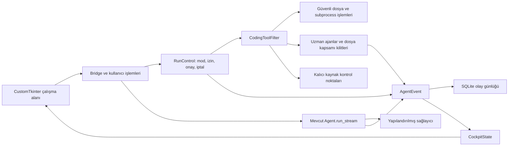

# Firik Kodlama Çalışma Alanı

6 Ekim 2026 tarihli kaynak geliştirmesi. Bu belge, mevcut Python/CustomTkinter uygulamasında yapılan değişiklikleri ve istek kapsamındaki 52 başlığın gerçek karşılığını açıklar. Evren üzerinde geliştirilen cockpit, Firik reposunun güncel `main` koduna ve paket adlarına uyarlanmıştır; bu repoda önceden bulunan ana ajan bağlam sıkıştırması korunur. Önceki [Kodlama Ajanı 2.0](CODING_AGENT_2.md) kaydı geçmiş davranışı anlatır; kontrol noktaları, uzman rolleri ve çalışma politikası için bu belge güncel kayıttır. Kaynak değişikliği, paketlenmiş masaüstü uygulamasının yayımlandığı anlamına gelmez.

## Mevcut mimari ve yeniden kullanılan parçalar

| Katman | Gerçek yapı | Bu geliştirmede yaklaşım |
| --- | --- | --- |
| Masaüstü arayüz | `ui/views/projects_view.py`, CustomTkinter/Tk, proje sekmeleri ve çalışma alanı mixin'leri | Mevcut proje/görev/Git/doküman/hafıza ekranları korunur. Kodlama alanında üç panel ve ayrı işlem görünümleri kullanılır. React, webview veya yeni bir UI framework'ü eklenmez. |
| UI ile yürütücü arasındaki sınır | `ui/service.py`, `ui/coding_bridge.py`, arka planda asenkron runtime, `_dispatch` ile ana Tk döngüsüne dönüş | `ui/coding_actions.py`, elle başlatılan terminal, kalite, ajan ve kontrol noktası işlemlerini aynı servise bağlar. Ayrı IPC sunucusu veya ikinci yürütücü oluşturulmaz. |
| Ajan döngüsü | `core/agent.py`, `Agent.run_stream`, `AgentEvent`, `ChatSession` | Olay protokolü korunur ve yeni metadata ile genişletilir. Model döngüsü, araç çalıştırma ve kullanıcı onayı aynı yaşam döngüsünü paylaşır. |
| İşlem politikası | `projects/coding_runtime.py`, `CodingRunControl`, `CodingToolFilter` | Boolean uyumluluk izinlerinin yanında `allow/ask/deny` politikası vardır. Doğrudan araç çağrısı da gerçek yürütücü denetiminden geçer. |
| Kalıcılık | `projects/db.py`, SQLite/WAL; `projects/coding_sessions.py` | Çalışma, konuşma, karar ve olay kimlikleri korunur. Kontrol noktası/inceleme tabloları mevcut DB kilidiyle eklenir. |
| Gözlenebilir durum | `projects/cockpit.py`, `CockpitState`, `AgentStatus`, tipli ajan/olay kayıtları | Kalıcı olayların sınırlı, pasif bir görünümü oluşturulur. Arayüzü yenilemek veya geçmişi açmak bir işlem çalıştırmaz. |
| Sağlayıcılar | `providers/registry.py`, `BaseProvider`, FIRIK ve OpenAI uyumlu sağlayıcılar | Yapılandırılmış yerel/uzak uç noktalar yeniden kullanılır. Model adına bakarak kapasite, fiyat veya araç desteği uydurulmaz. |
| Bağlam | `projects/context_builder.py`, `coding_service.py`, `indexer.py`, proje hafızası/ADR/beceri sistemi | Her model turunda güncel, proje kimliğiyle sınırlandırılmış kaynak seçimi; gerçek seçim gerekçeleri ve seri hale getirilmiş isteğin tahmini gösterilir. |
| Git ve IDE | `projects/git_service.py`, `git_state.py`, mevcut `GitView`, editör açma servisi | Tek GitStateStore proje başlığı, gezgin ve Git görünümüne sürümlü çalışma ağacı durumu yayınlar. Git görünümü gerektiğinde yüklenir. Kaynak düzenleme ve kontrol noktası için kullanıcı index/stash/dal durumunu değiştiren Git komutu çalıştırılmaz. |
| Uzmanlar | `projects/specialists.py`, `subagents.py` | Gerçek `Agent.run_stream` çocukları, daraltılmış izinler, dosya kapsamı kilitleri, bağımlılıklar ve görünür iletişimle genişletilir. |

Başlangıç denetimi; mevcut temel özelliklerin çoğunun zaten çalıştığını, ancak işlem kanıtının sohbet ve küçük kontrol etiketlerine dağıldığını gösterdi. Model metadata varsayımları, görünmeyen bağlam seçimi, belleğe bağlı geri alma, salt okunur uzman sınırı ve tamamlanma sırasında eskimiş test kanıtı ürün hedefi açısından önemli boşluklardı. Değişiklikler bu sınırları mevcut serviste genişleten dikey dilimler halinde yapılır.

## Olaydan arayüze akış



`project_id`, `session_id`, `run_id`, `task_id` ve çocuk `agent_id` kayıt ve olay sınırlarında taşınır. `CockpitState` işlem başlatan bir controller değildir; olayları ajan hiyerarşisi, etkinlik, terminal, doğrulama ve özet verisine çevirir. Aynı model isteğinin tekrar gelen kullanım frame'leri aynı istek kaydını günceller; her frame yeni token harcaması olarak toplanmaz.

## İstek kapsamındaki 52 başlığın karşılığı

**Yeni:** bu çalışma ekledi. **Geliştirildi:** mevcut çalışan davranış genişletildi. **Korundu:** mevcut özellik yeniden kullanıldı. **Kısmi:** somut çalışan parça var, satırdaki sınır tamamlanmış bir özellik gibi sunulmaz. **Süreç:** ürün özelliği yerine uygulama/doğrulama yaklaşımıdır.

| # | İstenen başlık | Durum | Kaynak karşılığı ve somut sınır |
| --- | --- | --- | --- |
| 1 | Mimari denetimi | Süreç | Mevcut UI, agent/provider, MCP, beceri, SQLite, Git, IDE, bağlam ve test akışı incelendi; yukarıdaki tablo yeniden kullanılan sınırları kaydeder. |
| 2 | Üç bölgeli workspace | Geliştirildi | Proje/Bağlam, merkez çalışma alanı, Ajan/Görev İnceleyicisi; Etkinlik, Plan, Değişiklikler, Terminal, Dosyalar, Git, Testler ve Sohbet. |
| 3 | Canlı etkinlik timeline | Yeni | Gerçek olaydan zaman, ajan, araç, dosya, komut, durum, çıktı/hata ve mevcut süre; filtrelenebilir ve açılır kanıt kartları. |
| 4 | Gerçek multi-agent workspace | Geliştirildi | Orchestrator ve araştırmacı/inceleyici/çalışan/test uzmanları; parent-child kimlikleri, gerçek durum, model/provider, kullanım ve ayrıntı görünümü. |
| 5 | Spawn/delegation | Geliştirildi | Kullanıcı/ana ajan gerçek çocuk başlatır. Yapılandırılmış provider/model ve çalışan için açık `write_paths`; çalışma boyunca çocuk/paralellik/token/maliyet sınırı. Ayrı çalışma dizini ve otomatik worktree yoktur. |
| 6 | Ajanlar arası iletişim | Yeni | Ana/çocuk/kardeş mesajları, kuyruk/teslim olayları ve bağımlı sonuçlar görünürdür. Mesaj model isteği sınırında teslim edilir; bağımsız contract deposu eklenmez. |
| 7 | Eşzamanlı düzenleme çakışması | Kısmi | Süreç içi örtüşen dosya/klasör kapsamı kilidi, gerçek beklenen SHA-256 ve çakışma hatası. Otomatik üç yönlü merge veya sürüm seçme wizard'ı yoktur. |
| 8 | Yapısal plan | Geliştirildi | Kimlikli adımlar, durum, kabul kriteri, doğrulama yöntemi, bağımlılık/ajan metadata'sı; olayla güncellenir. Tamamlanan adıma güncel gerçek kanıt gerekir. |
| 9 | Görev bağımlılıkları | Yeni | Plan döngüsü/bağımlılık doğrulaması ve çocuk `depends_on`; başarısız/iptal önkoşul aşağı akışı engeller. Grafik çizici eklenmez. |
| 10 | Bağlam inceleyicisi | Yeni | Kategoriler, gerçek dahil edilen dosya/satır/gerekçe; pin/her zaman dahil/çıkar/hiç dahil etme/yerel sıkıştırma tercihleri. Token değerleri etiketli yerel tahmindir; bu inceleyicinin kaynak sıkıştırması deterministik excerpt'tir. Firik'in mevcut ana ajan konuşma sıkıştırması ayrıca korunur. |
| 11 | Model/provider yönetimi | Geliştirildi | Doğrulanmış nullable kapasite, araç, vision, reasoning, structured output ve fiyat metadata'sı; çocuk başına yapılandırılmış seçim. Bildirilmeyen değer açık gerekçeyle gösterilir. |
| 12 | Yerel modeller | Geliştirildi | Mevcut OpenAI uyumlu endpoint yapılandırması; gerçek `/models` sağlık/gecikme sorgusu. Ollama/LM Studio/llama.cpp/MLX/vLLM endpoint'i uyumluysa kullanılır; sunucu veya model kurulmaz. |
| 13 | Performans ölçümleri | Kısmi | İstek gecikmesi, TTFT, retry ve sağlayıcının bildirdiği çıktı tokenı varsa token/sn; giriş/çıkış/cache kullanım metadata'sı. Prompt işleme hızı, RAM, VRAM, KV cache ölçümü yoktur. |
| 14 | Token/maliyet inceleyicisi | Geliştirildi | Sağlayıcı kullanımını istek ve ajan kimliğiyle toplar; doğrulanmış fiyatlardan cache-aware tahmin veya bildirilen maliyet. Eksik kullanım/fiyat sıfır harcama olarak sunulmaz. Ana ajan sıkıştırmasının özet çağrısı kullanım makbuzu vermediğinden sayaç tüm çağrıların toplam maliyetini kanıtlamaz. |
| 15 | İzin sistemi | Yeni | Filesystem, shell, network, Git, MCP, sırlar ve spawn için `allow/ask/deny`; miras daraltılır. Sır/sudo/force-push sabit deny, sandbox olmayan shell/MCP ayrı onay sınırında kalır. |
| 16 | Execution mode | Yeni | Güvenli, Yardımlı, Otonom, Özel; Soru Sor/Planla ve eski `approved/auto` kayıtları uyumludur. Otonom etiketi OS sandboxı olduğu anlamına gelmez. |
| 17 | Sır koruması | Geliştirildi | Hassas adlar/klasörler, symlink/hardlink engeli; bağlam/olay/export süzme; kontrol noktasında sır içeren kaynak tamamen atlanır. Her olası serbest metin sırrını tanıyan DLP değildir. |
| 18 | Ağ görünürlüğü | Kısmi | Model endpoint'i ve MCP/ağla ilgili araç olayları görünürdür; ağ politikası shell/MCP kapısını daraltır. Shell'in yaptığı tüm DNS/HTTP trafiği izlenmez ve domain bazlı firewall yoktur. |
| 19 | Terminal | Yeni | Gerçek komut/çıktı, cwd, durum, çıkış kodu ve süre; kullanıcı komutu başlatabilir ve yeniden çalıştırabilir. Etkileşimli PTY devralma veya terminal emülatörü yoktur. |
| 20 | Test/kalite kapıları | Yeni | Manifest/config kaynaklı tests/lint/typecheck/build/security komutları, etkin/gerekli tercihi, gerçek sonuç ve kaynak sürümüne bağlı kanıt. Çalıştırılmayan kontrol başarı sayılmaz; test case sayısı parser'ı yoktur. |
| 21 | Güvenlik kontrolleri | Kısmi | Hassas kaynak süzgeci, komut politikası ve `security` kalite kapısı türü mevcut araçla çalışabilir. Otomatik dependency CVE/SAST/lisans motoru veya yeni scanner paketi eklenmez. |
| 22 | Diff review | Geliştirildi | Gerçek dosya/satır farkı, IDE'de aç, ajana sor, güvenli geri al; kontrol noktası karşılaştırma arayüzünden revision-bound dosya/hunk accept/reject. Fark ve blok metni gerektiğinde açılır. Syntax renklendirmesi diff satırı türüne göredir; tam dil parser'ı yoktur. |
| 23 | Checkpoint/rollback | Yeni | Proje/çalışma kapsamlı SQLite snapshot, otomatik işlem/dosya öncesi kayıt, compare/restore ve geri dönüş yedeği. Git/non-Git aynı güvenli abstraction; stash/reset/index'e dokunmaz. |
| 24 | Canonical Git state | Geliştirildi | `GitStateStore` proje çalışma alanı başlığı, gezgin ve GitView için gerçek yerel durumun tek sürümlü kaynağıdır; branch/dirty/files/ahead-behind. Projeler listesindeki geçmiş branch metadata'sı canlı Git status değildir. |
| 25 | Proje gezgini | Geliştirildi | Lazy klasör yükleme, dosya/içerik arama, Git işaretleri, bağlam/pin/harici IDE/dosya yolları ve native klavye seçimi. Tam IDE explorer paritesi iddia edilmez. |
| 26 | Code intelligence | Kısmi | Mevcut AST/sembol ve import/dependency metadata'sı yeniden kullanılır; ham dosya aramasının yanında sembol aracı vardır. LSP definitions/references/diagnostics sunucusu eklenmez. |
| 27 | İndeks durumu | Kısmi | Gerçek kayıttan kaynak/sembol/import ilişkisi sayıları gösterilebilir. Embedding/semantic index hazır olduğu söylenmez; sürekli indeksleme progress motoru yoktur. |
| 28 | Arama | Geliştirildi | Dosya adı, içerik ve konuşma aramaları ayrıdır; sembol arama runtime'da vardır. Embedding tabanlı anlamsal arama yoktur. |
| 29 | MCP | Geliştirildi | Seçili ve açık izinli MCP araç çağrıları mevcut gerçek event/duration/error akışıyla görünürdür; MCP ayarı aynı izin/beceri diyalogundan açılır. Yan etkili otomatik retry yapılmaz. |
| 30 | Beceriler | Geliştirildi | Metadata katalogu, yalnız seçilen talimatların progressive yüklenmesi, composer seçimleri ve bağlam gerekçesi. Skill seçimi genel sınırsız plugin araçlarını etkinleştirmez. |
| 31 | Hafıza | Korundu/Geliştirildi | Proje hafızası, kabul edilmiş ADR, kullanıcı tercihleri, önceki oturum ve geçici konuşma ayrılır; dahil edilen hafıza kapsamı raporlanır. Ayrı agent-learning lifecycle deposu yoktur. |
| 32 | ADR | Korundu | Mevcut ADR ekranı ve kabul edilmiş kararların bağlam retrieval'ı. Her mimari değişiklikte otomatik ADR önerisi/oluşturma eklenmez. |
| 33 | Composer | Geliştirildi | Multiline giriş; proje kapsamlı `@file/@folder/@agent/@memory/@terminal/@commit`, skill/MCP ve slash komut parser/suggestions. Seçim izin vermez; ilgili güncel kayıt hazırlanırken tekrar doğrulanır. |
| 34 | Canlı yönlendirme | Yeni | Kullanıcı ana/çocuk ajana kuyruklu mesaj gönderebilir; sonraki model sınırında olayla teslim edilir. Devam eden tek model tokenını veya çalışan subprocess'i yeniden yazmaz. |
| 35 | Komut paleti | Geliştirildi | Arama, ↑↓/Enter/Esc; görünüm/ajan/model/terminal/test/bağlam/checkpoint/izin/MCP/beceri/pause/resume/stop/IDE/geçmiş/görünüm işlemleri gerçek handler'lara bağlıdır. |
| 36 | Keyboard-first UX | Geliştirildi | Platform Cmd/Ctrl, 1–8 görünüm, K palet, Shift+A ajan, Enter çalıştır, nokta durdur, F konuşma arama; binding'ler görünüm yaşam döngüsüyle temizlenir. |
| 37 | Responsive paneller | Geliştirildi | Resize/collapse, dar pencerede tek yardımcı panel; panel genişliği/görünürlüğü/seçili görünümler proje tercihlerine yazılır. |
| 38 | Görsel hiyerarşi | Geliştirildi | Merkez öncelikli layout, kompakt secondary/ghost eylemler, ayrı kırmızı durdurma, metin/ikon durumları ve belirgin onay çağrısı. |
| 39 | Tipografi | Geliştirildi | Konuşma/kod/terminal/metadata ayrımı; yazı boyutu kontrol panelinden Görünüm paletine taşındı. Bütün OS/font kombinasyonları için sertifikalı okunabilirlik ölçümü yoktur. |
| 40 | Proje bilgi mimarisi | Geliştirildi | Genel Bakış/Kodlama/Git/Ayarlar doğrudan; görev/özellik/backlog/roadmap/hata/AI PM Planlama grubunda, doküman/ADR/hafıza/arama Bilgi grubunda. Eski bütün handler ve alanlar korunur. |
| 41 | Türkçe ürün dili | Geliştirildi | Ortak `coding_strings.py` mod/durum/izin/görünüm etiketleri; teknik Git/MCP/API/token terimleri korunur. Veri tabanı ve araç API kimlikleri geriye uyumludur. |
| 42 | Empty state | Geliştirildi | Proje analizi, özellik, hata, test, kod açıklama ve inceleme için gerçek composer hazırlama/focus; ajan oluşturma palet/inceleyicide. Quick action kendiliğinden komut çalıştırmaz. |
| 43 | Hata deneyimi | Geliştirildi | Kalıcı işlem hatası, ajan/araç/çıktı kanıtı; terminali yeniden çalıştır, izinleri aç, ajana sor ve durdur. Model/yan etkili araç çağrıları otomatik yinelenmez. |
| 44 | Tamamlanma özeti | Yeni | Gerçek fark sayıları, doğrulama, ajanlar, token, mevcut maliyet/süre ve diff/Git/devam aksiyonları. Otomatik commit/PR açma yoktur. |
| 45 | Audit log | Geliştirildi | Çalışma kapsamlı yapılandırılmış olay/karar/journal; tool/read/write/shell/MCP/onay/ajan/checkpoint olayları kaydedilir. Shell'in tüm sistem çağrıları tutulmaz. |
| 46 | Performans | Geliştirildi | Sınırlı projection/kart sayısı, sadece açılan çıktı, lazy explorer ve Git; kaynak/fark/çıktı byte/satır sınırları. Tüm eski olaylar için tam scroll virtualization motoru yoktur. |
| 47 | Erişilebilirlik | Kısmi | Native Tk focus/klavye/listbox/Treeview, metin+ikon durumları, görünür kısayollar. ARIA web DOM özelliğidir; bu desktop UI'ya uygulanmaz. Screen-reader/kontrast sertifikasyonu ayrıca gerekir. |
| 48 | Domain state mimarisi | Yeni | `AgentStatus`, tipli ajan/olay kayıtları, `CockpitState`, `QualityGateSpec`, `SubagentLimits`, mevcut `CodingSession/RunControl` ve kalıcı checkpoint kayıtları. Eski UI state'i uyumluluk için korunur. |
| 49 | Event-driven runtime | Geliştirildi | Mevcut `AgentEvent` genişletilir; UI gerçek event projection'dan beslenir. Ayrı event bus veya paralel sahte backend eklenmez. |
| 50 | Kalite kriterleri | Süreç | Kritik policy, context, delegation, kalite kanıtı, checkpoint ve native UI testleri eklenir. Kontrollü test provider'ı dış sunucu testi gibi sunulmaz; doğrulama kapsamı aşağıdadır. |
| 51 | Incremental uygulama | Süreç | UI/domain/event, gerçek işlemler, context/provider, politika/quality ve kalıcı rollback mevcut modüllerde dikey dilimlerdir. Yeni büyük dependency veya framework yoktur. |
| 52 | Çalışma ve raporlama | Süreç | Denetim/plan, kod karşılıkları, test kanıtı ve açık kalan özellikler bu belge ile sonuç raporunda kaydedilir. Kullanıcı Firik reposuna commit/push işlemini istedi; uygulamanın çalışma tamamlanması kendiliğinden commit/PR/deploy başlatmaz. |

## Kullanım ve kısayollar

Mac'te aşağıdaki **birincil tuş** `Cmd`, Windows/Linux'ta `Ctrl`'dür. Kısayol sadece kodlama alanı açıkken etkin olur; ayrı dialog penceresine yanlışlıkla çalışma alanı eylemi taşımaz.

| Kısayol | İşlem |
| --- | --- |
| Birincil + 1–8 | Etkinlik, Plan, Değişiklikler, Terminal, Dosyalar, Git, Testler, Sohbet |
| Birincil + K | Aranabilir komut paleti |
| Birincil + Shift + A | Ajan oluşturma |
| Birincil + Enter | Composer isteğini çalıştır |
| Birincil + . | Çalışmayı durdur |
| Birincil + F | Konuşmada ara |
| Enter / Shift + Enter | Composer'da çalıştır / yeni satır |
| ↑↓ / Enter / Esc | Palet seçimi / çalıştır / kapat |

1. Projeyi açın; sol gezginden kaynak seçin veya composer'da proje kapsamlı referans kullanın. Bağlam inceleyicisinde seçim gerekçesini, satır aralığını ve tahmini görün.
2. Soru Sor/Planla kaynak değiştirmez. Güvenli mod düzenlemeyi onaya taşır; Yardımlı sıradan düzenlemeleri izin kapsamıyla uygular. Otonom da sandbox bulunmadığı için shell/MCP güvenlik sınırını korur. Özel modda görünür politika tercihleri kullanılır.
3. Etkinlik işlem kanıtını, Terminal gerçek subprocess çıktısını, Testler gerçek doğrulamayı gösterir. Reddedilen veya hiç çalışmayan kontrolü başarı olarak değerlendirmeyin.
4. Düzenleyen uzman başlatırken açık dosya/klasör kapsamı verin. Araştırmacı ve inceleyici kaynak değiştirmez; test uzmanı izinli doğrulamayı çalıştırır. Ana izinler çocuk tarafından genişletilemez. Kapsam kilidi dosya API'lerini kapsar; onaylı test süreçlerinin bütün yan etkilerini dosya kapsamına hapseden OS sandboxı yoktur.
5. Yönlendirme bir sonraki model isteğinde teslim edilir. Durdur tüm ana/çocuk yaşam döngüsünü sonlandırır; Duraklat devam eden işletim sistemi komutunu dondurmak yerine sonraki ajan sınırında bekletir.
6. Değişiklikleri inceleyin. Kontrol Noktaları/Kayıtlar bölümünde önce karşılaştırın, sonra incelenen dosyaları geri yükleyin. İşlem yeni geri dönüş kaydını önce saklar.

## Kalite komutları ve tamamlanma

`projects/quality_gates.py`, komut çalıştırmadan mevcut manifestleri okur. `package.json` script'lerinden test/lint/typecheck/build; Python manifestinden pytest/ruff/mypy/build; Cargo ve Go manifestlerinden ilgili araçlar; Makefile'dan ilan edilmiş target'lar seçilir. Bu keşif, ilgili aracın makinede kurulu olduğunu veya projenin komutunun güvenli olduğunu kanıtlamaz. Kullanıcı onayı ve gerçek çıkış kodu gereklidir. Paket yüklemek veya eksik aracın yerine sahte başarı yazmak keşif aşamasının parçası değildir.

Yapılandırılmış kapı örneği:

```json
[
  {"id": "unit", "kind": "tests", "command": "python -m pytest", "required": true, "enabled": true, "timeout": 120},
  {"id": "lint", "kind": "lint", "command": "python -m ruff check .", "required": true, "enabled": true, "timeout": 60}
]
```

Kalite kanıtı komut, çıkış kodu ve workspace sürümüne bağlıdır. Sonraki ajan/harici kaynak değişikliği önceki kanıtı eskitebilir. `completion_gate` plan adımları ve gerekli kalite kapıları için güncel kanıt arar; modelin “testler geçti” demesi bu kanıtı üretmez. Konuşma turunun bitmesi, bağlı proje görevinin otomatik `Done` olması anlamına gelmez.

## Kontrol noktaları ve kesinti kurtarma

`CheckpointStore` bütün depolarda aynı yerel snapshot abstraction'ını kullanır. Git deposunda index, branch, stash ve kullanıcıya ait dirty başlangıç korunur. Checkpoint başına en fazla 2.000 dosya, toplam 20 MiB ve dosya başına 1 MiB kaynak UTF-8 metni vardır. İkili/geçersiz UTF-8, bağımlılık/build klasörleri, hassas dosyalar, symlink/hardlink ve sır desenine/bilinen sağlayıcı sırrına takılan metinler kayda alınmaz. Kısmi kaydın dışındaki dosyalar yokmuş gibi değerlendirilmez.

Restore, compare sırasında görülen her dosyanın SHA-256 özetini ister. İnceleme sonrasında değişen dosya korunur; sonradan oluşturulan ilgisiz kullanıcı dosyası işleme eklenmez. Dosya/hunk reddi de aynı revision denetimini ve önce kalıcı yedek kaydetmeyi kullanır. Hunk reddi diğer kabul edilmiş, benzersiz ve değişmemiş blokların kararını taşır; kullanıcı değişikliğinden sonra eski karar otomatik geçerli sayılmaz.

Tek dosya yayını atomiktir. Çok dosyalı restore bir filesystem transaction'ı değildir: normal hata halinde yazılmış dosyalar, hâlâ bizim yazdığımız içeriği taşıyorsa geri alınır. Süreç kesintisinde kalıcı yedek ve `applying` işlem kaydı kalır. Açılışta workspace otomatik değiştirilmez.

Kurtarma akışı:

1. Devam eden aynı proje ajanını durdurun. Geçmiş çalışma açıldığında kesintiye uğramış olarak kalır; kendiliğinden model/komut başlatılmaz.
2. Kayıtlar'dan son **Geri yükleme öncesi** veya **Düzenleme öncesi** checkpoint'i karşılaştırın.
3. Harici kullanıcı düzenlemesini inceleyin. Yeni compare ile verilen hash'ler üzerinden açık restore yapın; eski hash veya redakte journal'dan kaynak üretmeyin.
4. API üzerinden `list_operations(project_id, run_id=...)`, `applying`/`needs_recovery` kayıtları ve `backup_checkpoint_id` ile yarım kalmış işlemi tanımlar. Bu liste kendisi onarım çalıştırmaz.
5. Kaynak sır nedeniyle atlanmışsa geri yüklenebilir içerik bulunmaz. Git/IDE veya kullanıcının mevcut yedeği üzerinden ilgili dosyayı ayrıca değerlendirin.

## Model ve bütçe doğruluğu

Yerel bağlam tahmini, gönderilecek seri hale getirilmiş mesaj ve seçili araç şemalarının karakter sayısının dörde bölünmesine dayanır. Provider tokenizer ölçümü değildir. Bağlam penceresi sadece doğrulanmış metadata varsa kapasite çubuğuna katılır. Kaynak sıkıştırması etiketli deterministik excerpt'tir; anlamsal model özeti değildir.

Kullanım alanları sağlayıcının bildirimidir. Cache fiyatı varsa ayrı hesaplanır; yoksa standart fiyat üzerinden tahmin açıkça etiketlenir. Eksik fiyat “Fiyat bilgisi sağlayıcı tarafından sunulmuyor” olarak gösterilir. Uç noktanın `/models` yanıtı online/gecikme kanıtıdır; belirli modelin inference kalitesini, kapasitesini veya tools desteğini kanıtlamaz.

Firik'in ana ajanında önceden bulunan model tabanlı konuşma sıkıştırması korunur. Bu özet çağrısı mevcut provider API'sinden token/maliyet kullanım makbuzu döndürmediği için cockpit sayaçları sağlayıcının bildirdiği kullanımı gösterir; tüm ücretli çağrıların eksiksiz toplamı değildir. Çocuk ajanda ücretli konuşma sıkıştırması kapatılır ve deterministik bağlam sınırı kullanılır. Böylece özet çağrısı çocuk token/maliyet rezervasyonunu aşan ayrı bir inference başlatamaz; ana ajanın veya paylaşılan agent factory'sinin sıkıştırma ayarı değiştirilmez. Uzun geri yüklenmiş geçmiş, tükenmiş token rezervi ve sıfır maliyet bütçesi için regresyon testleri vardır.

Uzman sınırları çalışma başında sabittir: varsayılan toplam 4 çocuk, eşzamanlı 2, 131.072 ihtiyatlı token rezervi, 8 tur, çocuk başına 120 saniye ve tek seviye. Yapılandırma tavanı 16 çocuk, 6 paralel ve 2 milyon tokendır. Bu rezerv provider usage ile aynı şey değildir. İsteğe bağlı maliyet bütçesi doğrulanmış fiyat gerekir; fiyatı olmayan çağrı kesin parasal bütçe altında çalışıyormuş gibi gösterilmez. Ayrı worktree, çocuk içinde recursive spawn veya harici editörü kilitleyen OS dosya kilidi yoktur.

## Doğrulama kanıtı ve yeniden çalıştırma

İlk Evren geliştirmesinde kontrol noktası diliminin gerçek yerel komutu:

```text
.venv/bin/python -m pytest tests/test_cockpit_checkpoints.py -q
19 passed in 0.57s
```

Bu sonuç; gerçek SQLite yeniden açılışı, dirty başlangıç, sıfırdan/deleted/boş kaynak geri alma, stale hash reddi, bağımsız hunk kararı, proje/run/root ayrımı, sır/ikili/FIFO/link süzme, kısmi snapshot, compare sonrası ilgisiz kullanıcı dosyası, hata rollback'i, kesinti kaydı, Git staged index ve paralel DB yazımını kapsar.

Diğer kritik dilimler şu test dosyalarındadır; güncel toplu sayılar son çalışma raporunda verilen gerçek komuta aittir:

| Dosya | Kanıt kapsamı |
| --- | --- |
| `tests/test_cockpit_runtime.py` | Policy/mode yürütümü, doğrudan çağrı kapısı, bağımlı plan, keşif/quality ve eskimiş kanıt |
| `tests/test_cockpit_context.py` | Gerçek bağlam seçimi/harici alanları dışlama, composer, doğrulanmış nullable metadata, cache maliyeti ve provider metrikleri |
| `tests/test_cockpit_subagents.py` | Gerçek kontrollü Agent döngüsü, worker/tester izinleri, provider/model çözümleme, mesaj, bağımlılık, bütçe, rezervsiz çocuk sıkıştırma çağrısının engellenmesi ve scope kilitleri |
| `tests/test_ui_cockpit.py` | Native Tk üç panel, görünüm/keyboard/palette/layout uyumluluğu |
| `tests/test_ui_cockpit_evidence.py` | Gerçek event projection, kanıt kartları, terminal/test/context/model/checkpoint UI ve sınırlı rendering |
| `tests/test_ui_chat.py` | Mevcut sohbet kaydırma regresyonunun Tk 9/X11 native MouseWheel ve önceki Tk Button-4/5 olaylarıyla taşınabilir koşumu |
| Mevcut `test_coding_*`, `test_subagents.py`, `test_ui_coding_*`, `test_projects.py` | Eski API, izin, kalıcılık, proje kimliği ve mevcut masaüstü özellikleriyle regresyon |

Kritik mantık için yerel koşum:

```sh
.venv/bin/python -m pytest tests/test_cockpit_runtime.py tests/test_cockpit_context.py tests/test_cockpit_subagents.py tests/test_cockpit_checkpoints.py -q
```

Native UI koşumu grafik/Tk ortamı gerektirir; Linux CI için mevcut X server veya Xvfb kullanılabilir. Testlerdeki kontrollü provider, gerçek dosya/subprocess/SQLite/ajan döngüsünü doğrular; dış FIRIK/Ollama/LM Studio bağlantısı ve paketlenmiş macOS/Windows dağıtımı ayrı kanıttır. TypeScript bu Python/Tk stack'inin parçası değildir; kurulmamış lint/typecheck aracının geçtiği iddia edilmez.

İlk Evren geliştirmesinin toplu doğrulaması yerel X server üzerinde şu komutla tamamlandı; bu tarihsel sonuç Firik entegrasyon koşumu değildir:

```text
DISPLAY=:98 .venv/bin/python -m pytest -q
598 passed, 1 skipped in 262.74s
```

Atlanan senaryo Windows `cmd` quoting regresyonudur; bu koşum Linux'tadır. O aşamadaki değişen/yeni 38 Python dosyasının Ruff `E9,F` kontrolü, `compileall`, Python 3.10 grammar ile AST parse ve `git diff --check` geçti. Yapılandırılmış bağımsız typechecker bulunmadığından AST kontrolü typecheck olarak adlandırılmaz. Depo genelinde bu kapsam dışındaki dosyalarda önceki lint hataları vardır; bütün deponun lint temiz olduğu iddia edilmez.

Firik entegrasyonunun toplu koşumu ayrıca tamamlandı. Bulut ortamında varsayılan kullanıcı dizini salt okunur olduğundan `Path.home()` yalnız test sürecinde yazılabilir geçici dizine yönlendirildi; testlerin kendi `HOME` seçimi korundu. Bu koşum yardımcısı depoya veya uygulama dependency'lerine eklenmez. Native UI testleri gerçek Tk 9/X server (`DISPLAY=:98`) kullandı. Bu süreçteki pytest çağrısı ve gerçek sonuç:

```text
pytest.main(["-q"])
617 passed, 1 skipped in 187.34s (0:03:07)
```

Bu Firik sonucu mevcut bağlam sıkıştırma testlerini ve eklenen çocuk bütçesi/Tk 9 regresyonlarını kapsar. Tek atlama yine Linux'ta uygulanamayan Windows `cmd` quoting senaryosudur. Yazılabilir normal kullanıcı dizini ve kurulu dependency'lerle aynı suite depo kökünden `.venv/bin/python -m pytest -q` komutuyla tekrar çalıştırılabilir.

Firik entegrasyonunda değişen/yeni 39 Python dosyasının Ruff `E9,F`, Python derleme ve Python 3.10 grammar ile AST parse kontrolleri; ayrıca `git diff --check` geçti. Bu kontroller bağımsız typechecker veya bütün depo için lint temizliği iddiası değildir.

```text
.venv/bin/python -m build --no-isolation --outdir /tmp/firik-cockpit-dist
Successfully built firik_agent-0.2.21.tar.gz and firik_agent-0.2.21-py3-none-any.whl
```

Firik wheel/sdist kaynak dağıtımı başarıyla oluşturuldu. Bu, paketlenmiş native uygulama dağıtımı veya dış sağlayıcı inference testi değildir. İlk Evren uygulaması ayrıca 1600×1000 ve 940×620 boyutlarında gerçek Tk/X server üzerinde açıldı; küçük diff görünümü, boş liste boyutu, dar panel eylemleri ve yeniden kurulan Git aboneliği doğrulandı. Bu ekran görüntüleri Firik sürümünün ayrı görsel doğrulaması olarak sunulmaz. Son entegrasyon regresyonları başlangıç öncesi iptal, audit yazma hatasında işlemin durdurulması, eski proje izinlerinin manuel işlemlere mirası ve engellenmiş çalışmanın kalıcı yeniden açılışını kapsar.

İlk Evren geliştirmesinde son Git aboneliği regresyonu dahil native cockpit dilimi ayrıca tekrar çalıştırıldı: `tests/test_ui_cockpit.py` için 5 test geçti (21.19 sn). O aşamadaki Evren wheel'i izole geçici dizine çıkarıldı; import'un bu wheel'den geldiği doğrulandı ve gerçek masaüstü `--smoke-test` başlangıcı başarıyla tamamlandı.

Firik wheel'inin başlangıcı da ayrıca doğrulandı: `firik_agent-0.2.21-py3-none-any.whl` izole geçici dizine çıkarıldı ve `firik_agent` import'unun o çıkarılmış wheel'den geldiği kontrol edildi. Gerçek Tk/X server üzerinde `--smoke-test` çıkış kodu 0 ile tamamlandı. Bu koşumda da yazılabilir geçici kullanıcı dizini yalnız süreç içinde seçildi. Her iki wheel smoke testi mevcut venv dependency'lerini kullanır; bağımlılıksız paketlenmiş executable testi değildir.

## Sonraki somut geliştirmeler

- Projeler liste kartlarının geçmiş branch badge'ini canlı Git state ile gerekçe/süre bilgisi üzerinden ayırmak; paylaşılan Git state yenilemesini açık dosya watcher olaylarına bağlamak.
- Dosya çatışması inceleyicisine açık üç yönlü diff/sürüm seçimi eklemek; otomatik merge ancak güvenli Git/worktree izolasyonuyla değerlendirmek.
- Terminale isteğe bağlı PTY ve işletim sistemi sandboxı; sonrasında gözlenen domain/ağ olayları ve kısıtların gerçek enforcement'ı.
- Mevcut indeks abstraction'ına isteğe bağlı LSP diagnostics/references bağlamak; embedding servisini açık kaynak ve maliyet sınırıyla ayrı özellik yapmak.
- Büyük gerçek repo/event geçmişi benchmark'ı, screen-reader/kontrast incelemesi ve paketlenmiş platform smoke testi yapmak.
- Hafıza/ADR önerisini mevcut kullanıcı onaylı kayıt akışına bağlamak; kaynak veya model metnini doğrudan kalıcı talimata çevirmemek.

## Değişen dosyalar

41 dosyanın (39 Python, 2 Markdown) kapsamı aşağıdadır. Çalışma yeni uygulama dependency'si eklemez.

| Grup | Dosyalar |
| --- | --- |
| Doküman | `README.md`, `docs/CODING_COCKPIT.md` |
| Ajan protokolü | `firik_agent/core/agent.py`, `core/events.py`, `core/types.py` |
| Proje/runtime | `firik_agent/projects/coding_runtime.py`, `coding_service.py`, `coding_sessions.py`, `context_builder.py`, `model_capabilities.py`, `specialists.py`, `subagents.py` |
| Yeni proje modülleri | `firik_agent/projects/checkpoints.py`, `cockpit.py`, `composer.py`, `context_inspector.py`, `git_state.py`, `quality_gates.py` |
| Provider | `firik_agent/providers/base.py`, `firik.py`, `openai_provider.py` |
| UI | `firik_agent/ui/coding_bridge.py`, `coding_history.py`, `coding_strings.py`, `coding_workspace.py`, `components/coding_explorer.py`, `views/git_view.py`, `views/projects_view.py` |
| Yeni UI modülleri | `firik_agent/ui/coding_actions.py`, `coding_evidence.py` |
| Runtime regresyonları | `tests/test_cockpit_actions.py`, `test_cockpit_checkpoints.py`, `test_cockpit_context.py`, `test_cockpit_projection.py`, `test_cockpit_runtime.py`, `test_cockpit_subagents.py` |
| Native UI regresyonları | `tests/test_ui_cockpit.py`, `test_ui_cockpit_evidence.py`, `test_ui_cockpit_explorer.py`, `test_ui_projects.py`, `test_ui_chat.py` |
