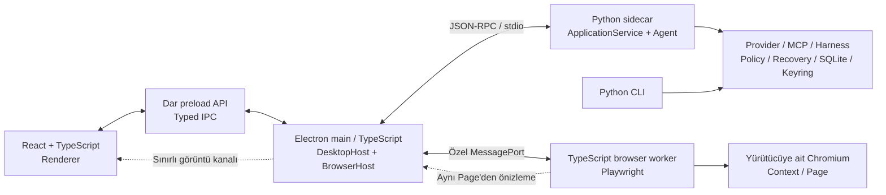

# Firik Agent hibrit masaüstü mimarisi

İlk plan: 9 Kasım 2026 (`a0c95be`, paket sürümü `0.2.51`). Güncelleme: 10 Kasım 2026.
Durum: Electron/React sohbeti, GUI bağımsız Python servisi ve özel stdio/IPC
bağlantısına TypeScript Playwright worker ve React browser paneli eklendi.
Aynı sayfa, onaylı tıklama ve elle kontrol macOS arm64 üzerinde gerçek Chromium
ile doğrulanıyor. Diğer ekranlar, platform paketleri ve gerçek gömme sonraki
kapılardır. Güncel kapsam ve kanıtlar: [geçiş dokümanı](HYBRID_DESKTOP_MIGRATION.md).

## Karar

Firik Agent için önerilen yapı **Electron + React + TypeScript masaüstü arayüzü,
TypeScript + Playwright tarayıcı yürütücüsü ve Python ajan çekirdeği**dir.
Uygulama macOS, Windows ve Linux'ta kurulan, kendi penceresi olan bir desktop
uygulaması olarak dağıtılır.

React ekranları ve bileşenleri oluşturur. TypeScript hem bu ekranlarda hem
Electron ana sürecinde ve browser servisinde kullanılır; derleme sonunda
JavaScript çalışır. Electron pencere, menü, dosya seçici ve uygulama yaşam
döngüsünü sağlar. Vite geliştirme/derleme aracıdır; dağıtılan uygulama yerel
derlenmiş dosyaları açar. Kullanıcının ayrıca Vite veya bir web sunucusu
başlatması gerekmez. Bu katmanlar Electron'un
[main / renderer / preload modeline](https://www.electronjs.org/docs/latest/tutorial/process-model)
uygundur.

Python tarafındaki ajan döngüsü, sağlayıcılar, harness, MCP, izinler, kalıcı
geçmiş, proje araçları ve kurtarma mekanizmaları ortak backend olarak kullanılır.
Yeni React ekranları bu backend'in istemcisidir. CLI aynı Python servislerini
Electron başlatmadan kullanmaya devam eder.

## Görseldeki teknoloji listesinin düzenlenmiş hali

| Alan | Seçim | Firik'teki sorumluluğu |
| --- | --- | --- |
| Desktop runtime | Electron | Pencere, menü, işletim sistemi entegrasyonu, alt süreçlerin yaşam döngüsü |
| UI | React + TypeScript | Sohbet, projeler, coding cockpit, ayarlar, MCP, ses ve browser paneli |
| Build tooling | Vite + ayrı main/preload/worker derlemeleri | Renderer ile Node/Electron kodlarının bağımlılıklarını ayırmak |
| Paket yöneticisi | Yarn workspaces | Tek JS kilit dosyası; uygulama ve sözleşme paketleri. İlk uygulamada Yarn/Node sürümleri sabitlenir |
| UI styling | Tailwind CSS | Ortak tasarım tokenları, koyu/açık tema, ölçeklendirme |
| UI components | shadcn/ui | Diyaloglar, menüler, form alanları; Firik'e uyarlanmış bileşenler |
| Yerel UI state | Zustand | Aktif sekme, panel boyutu, taslak ve geçici görünüm durumu |
| Backend state | TanStack Query | Model/kota/proje/geçmiş snapshot'ları; olaylarla güncellenen önbellek |
| Akışlı yanıtlar | Türlenmiş event aboneliği | Token, araç, onay ve run olayları; token başına polling yapılmaz |
| Code editor | Monaco Editor | Dosya/diff görünümü; okuma, yazma ve LSP işlemleri backend üzerinden |
| Terminal görünümü | xterm.js | Mevcut komut çıktılarının gösterimi; etkileşimli PTY ayrı teslimat |
| Browser automation | TypeScript + Playwright, ayrı Node worker | Chromium, context, sekme, gözlem, giriş ve görüntü yakalama |
| Browser paneli | İlk geçişte React görüntü önizlemesi | Kullanıcının ve ajanın aynı Playwright `Page` nesnesiyle çalışması |
| Gerçek gömülü browser | Ayrı aşamada Electron `WebContentsView` prototipi | Görünen sayfanın kendi Chromium görünümü; sürücü uyumu kabul kapısına bağlı |
| Data validation | Ortak JSON Schema; TS'de Zod, Python'da Pydantic | IPC sınırlarında çalışma zamanı doğrulaması ve sözleşme uyumu |
| UI ↔ desktop host | Türlenmiş Electron IPC + dar preload API | İzinli uygulama işlemleri ve olay abonelikleri |
| Desktop host ↔ agent | Çift yönlü JSON-RPC 2.0 / stdio | Python sidecar çağrıları ve Python'dan browser yürütme istekleri |
| Agent core | Mevcut Python | Agent, provider, MCP, harness, policy, recovery ve kalıcı verilerin sahibi |
| Packaging | electron-builder + ayrı PyInstaller backend paketi | Tek desktop kurulumunun içinde Electron, Python sidecar ve browser dosyaları |

Paketleme için `electron-builder` seçmek bu proje için tasarım tercihidir;
görseldeki “Forge veya builder” belirsizliğini kaldırır. Vite derlemesi paketleyiciden
bağımsız tutulur. Forge'un kendi
[Vite eklentisi](https://www.electronforge.io/config/plugins/vite)
inceleme tarihinde hâlâ experimental olarak işaretlidir.

## Süreçler ve sahiplik



Electron main, Python sidecar ile browser worker'ı başlatır ve kapatır. BrowserHost,
worker'a giden dar komut kümesini ve oturum eşlemesini yönetir. Playwright işi
main'in olay döngüsünü meşgul etmez. Worker için Electron'un Node alt süreç
mekanizması [utilityProcess](https://www.electronjs.org/docs/latest/api/utility-process)
önerilir; paketlenmiş uygulamada Playwright sürücüsünü/Chromium'u başlatabildiği
ilk prototipte ayrıca sınanır. Bu süreç ayrımı kendi başına OS sandbox garantisi
vermez.

Python, iş kuralları ve kalıcı durum için yetki sahibidir. TypeScript BrowserHost
tarayıcı nesnelerinin ve yürütmenin sahibidir. Python, browser çağrılarını mevcut
tool filter, onay ve execution journal üzerinden geçirerek BrowserHost'a iletir.
TypeScript tarafı da güncel yetki kapsamını ve oturum sahipliğini yürütme anında
denetler. Worker yeni model döngüsü veya bağımsız izin politikası oluşturmaz.

Zustand UI tercihlerini, TanStack Query backend durumunun önbelleğini tutar.
Sohbet/run/proje verisinin kalıcı kaynağı Python'daki SQLite depolarıdır.
Renderer aynı veritabanına ikinci bir yazıcı olarak bağlanmaz. Anahtarlar mevcut
Python keyring servisinde kalır; UI yalnızca anahtarın yapılandırılmış olup
olmadığını görür. Kullanıcının ayarlarda girdiği yeni anahtar yazma çağrısıyla
aktarılır; geri okuma veya loglama API'si sunulmaz.

## Tarayıcı: otomasyon ve gerçek gömme ayrı işler

Mevcut [BrowserManager](../firik_agent/browser/manager.py) Python Playwright ile
Chromium'u yönetiyor. [BrowserPanel](../firik_agent/ui/components/browser_preview.py)
aynı sayfanın görüntülerini gösteriyor ve devralma sırasında kullanıcı girişini
o sayfaya iletiyor. Bu davranış ilk TypeScript geçişinde korunabilir: Playwright
worker ve React panel aynı `context_id / tab_id / revision` ile çalışır. UI için
ikinci bir tarayıcı açılmaz, çerezler başka motora kopyalanmaz.

İlk hibrit sürümde TypeScript Playwright, kendi sürümüyle eşleşen Chromium'u
başlatır. Bu nedenle Electron'un Chromium'u ile Playwright'ın browser paketi iki
ayrı dağıtım yükü oluşturabilir. Playwright'ın
[browser sürümü gereksinimi](https://playwright.dev/docs/browsers)
nedeniyle yalnızca Electron kurmanın yeterli olduğu varsayılmaz. RAM, açılış
süresi ve paket boyutu prototipte ölçülür; başlangıçta sayı tahmin edilmez.

Tam gömülü, doğrudan etkileşimli sayfa istendiğinde hedef
[WebContentsView](https://www.electronjs.org/docs/latest/api/web-contents-view)
olur. React sekmeleri ve adres çubuğunu çizer; Electron main gerçek sayfa
görünümünü oluşturup yerleşimini yönetir. Electron'un önerisi nedeniyle yeni
tasarımda [`<webview>` etiketi](https://www.electronjs.org/docs/latest/api/webview-tag)
tercih edilmez.

Playwright'ın [Electron otomasyonu](https://playwright.dev/docs/api/class-electron)
experimental'dır. Playwright eklemek veya aynı URL'yi iki yerde açmak,
`WebContentsView` ile aynı sayfanın kontrol edildiğini kanıtlamaz. Üretim
mimarisi bu varsayıma bağlanmaz. `BrowserExecutor` arayüzü önce
`PlaywrightBrowserExecutor` ile uygulanır; gömülü görünüm prototipi aynı arayüz
altında ayrı `ElectronBrowserExecutor` olarak değerlendirilir. Electron'un
[webContents.debugger CDP taşıması](https://www.electronjs.org/docs/latest/api/debugger)
bu prototip için bir adaydır; hazır Playwright locator/auto-wait eşdeğeri olduğu
iddia edilmez. Üretimde açık remote-debugging portu kullanılmaz.

Gömülü görünümün kabul kapısı: kullanıcı ve ajan aynı `webContents`/sayfayı
değiştirir; devralma, eski referans reddi, parola gizliliği, izin iptali ve ağ
politikası üç platformda çalışır. Yerleşim ayrıca HiDPI, zoom, klavye odağı ve
React diyaloglarıyla sınanır. BaseWindow kullanılırsa eklenen görünümlerin
`webContents` nesneleri
[açıkça kapatılır](https://www.electronjs.org/docs/latest/api/base-window#resource-management).
Bu kapı geçilene kadar görüntü önizlemesi ürün içinde gerçek webview olarak
adlandırılmaz; hata halinde iki motor arasında sessiz geçiş yapılmaz.

## IPC sözleşmesi

İki sınır ayrı tutulur. Renderer yalnızca `window.firik.chat.start(...)`,
`window.firik.runs.cancel(...)`, `window.firik.approvals.resolve(...)` gibi
tanımlı preload yöntemlerini çağırır. Genel `invoke(channel, payload)`, kabuk,
dosya sistemi veya ham CDP API'si renderer'a açılmaz. Electron main, gönderen
`webContents`, ana frame ve uygulama origin'ini doğrular. Bu yaklaşım
[contextBridge rehberiyle](https://www.electronjs.org/docs/latest/tutorial/context-isolation)
uyumludur.

Python sidecar ile main arasında çift yönlü JSON-RPC gerekir: UI Python'a iş
başlatırken Python da browser yürütme/gözlem isteği gönderebilir. Sürekli açık
localhost HTTP/WebSocket sunucusu ilk sürüm için gerekli değildir. Worker
kanalı main'in özel MessagePort'udur; model, renderer veya web sayfası bu porta
doğrudan erişemez.

| Yön | Önerilen yöntem ailesi | Amaç |
| --- | --- | --- |
| Main → Python | `system.hello`, `state.snapshot` | Protokol/capability anlaşması ve güncel durumu alma |
| Main → Python | `chat.start`, `coding.start`, `run.cancel` | Mevcut servisler üzerinden yürütme |
| Main → Python | `approval.resolve`, `browser.userCommand` | Gerçek kullanıcının kararını/komutunu sahipliğine bağlama |
| Python → Main | `browser.prepare`, `browser.execute`, `browser.revoke` | Güncel sayfa önizlemesi, yetkilendirilmiş yürütme ve iptal |
| Python → Main | `agent.event` bildirimi | Mevcut AgentEvent türlerinin dış protokole uyarlanması |
| Main ↔ Worker | Türlenmiş BrowserExecutor komutları | İlgili context/page üzerinde sınırlı browser işlemleri |

Ortak sözleşmelerin kuralları:

1. Protokol ana sürümü ve gerçek yetenekler `system.hello` ile karşılaştırılır;
   uyumsuz backend ile çalışma başlatılmaz. Bilinmeyen yetenek desteklenmiş
   sayılmaz.
2. JSON Schema wire sözleşmesinin ortak kaynağıdır. TS türleri/Zod doğrulayıcıları
   ve Python Pydantic modelleri buna göre üretilir veya aynı fixture'larla
   uyumluluğu sınanır. Bağımsız elle yazılmış iki model yeterli sayılmaz.
3. Stdio, satır başına bir JSON-RPC iletisi taşır. `stdout` yalnız protokole,
   `stderr` gizli değerlerden arındırılmış loglara ayrılır; üçüncü taraf/MCP
   çıktısı protokol akışına karışmaz. Çerçeve boyutu ve kuyruklar sınırlanır.
4. Host güvenilir UI bağlamından konuşma/proje/run eşlemesi oluşturur; Python
   sahipliği tekrar denetler. Model argümanları identity, origin grant veya
   approval yetkisi belirleyemez. Rastgele bir ID tek başına yetki sağlamaz.
5. Onay; kanonik argümanlar, mevcut sayfa revision/fingerprint ve güncel grant
   sürümüne bağlanır. Worker'ın yürütme yetkisi dar, süreli ve tek kullanımlı
   olur. İzin iptali main ve worker'a öncelikli iletilir; süre aşımı/bağlantı
   kaybında yeni işlemler durur. Hazırlama ile yürütme arasında tekrar denetim
   yapılır.
6. Python, browser dispatch öncesi mevcut ExecutionJournal'a intent kaydeder.
   RPC request ID deduplication anahtarı değildir; etkili işlemler ayrı
   execution ID ile izlenir. Worker çökmesi, timeout veya iptal sonucun belirsiz
   kalmasına yol açabilir; bu işlemler otomatik tekrar edilmez.
7. Event'ler `backend_instance_id`, `run_id`, sıra numarası ve olay türü taşır.
   UI yeniden bağlanınca snapshot alır; tampon yetiyorsa aynı backend instance'ı
   içindeki olay farkını uygular. Sıra numarası sıfırlanan yeni backend ile eski
   olaylar birleştirilmez; mevcut günlüklerin eksiksiz event replay sağladığı
   varsayılmaz.
8. Token güncellemeleri kısa aralıklarla birleştirilebilir; onay, araç sonucu,
   hata ve run sonlanma olayları kaybedilmez. Yavaş renderer, backend'e sınırsız
   bellek kuyruğu oluşturmaz.
9. Görüntü/ses ham verisi ve parola alanları JSON-RPC/event günlüğüne eklenmez.
   Önizleme ayrı, sınırlı binary kanaldan taşınır; kalıcı kanıt gerekiyorsa
   sahiplik denetlenen artifact handle kullanılır. UI'da önizleme görmek modele
   görsel gönderme izni anlamına gelmez.

## Mevcut kaynakların geçiş eşlemesi

| Mevcut kaynak | Yapılacak iş |
| --- | --- |
| `firik_agent/ui/app.py`, `ui/views/`, `ui/components/` | Ekranlar ve kullanıcı etkileşimleri React'e taşınır; desktop özellikleri main'e bağlanır |
| `firik_agent/ui/service.py` | FirikService'in iş servisleri GUI bağımsız `application/` katmanına çıkarılır; callback dispatch UI adaptöründe kalır |
| `ui/coding_bridge.py`, `ui/coding_actions.py`, `ui/improvement_bridge.py` | İş mantığı backend'e alınır; hem Tk geçiş istemcisi hem RPC aynı servisi çağırır |
| `firik_agent/core/`, `providers/`, `mcp/`, `projects/`, `harness/`, `self_improvement/` | Python servisleri kullanılır; yeni UI için ikinci ajan döngüsü oluşturulmaz |
| `firik_agent/core/events.py` | AgentEvent dış protokol adaptöründen geçirilir; Python iç nesneleri IPC'ye doğrudan serialize edilmez |
| `firik_agent/core/runtime.py` | İlk backend'de mevcut AsyncRuntime yeniden kullanılır; RPC giriş döngüsüyle thread/loop sahipliği açıkça bağlanır |
| `firik_agent/browser/manager.py` | Yürütme/context/page işlemleri TS Playwright worker'a taşınır; Python'da RPC tabanlı BrowserExecutor adaptörü kalır |
| `browser/tool_adapter.py`, `core/session.py` ve coding policy | Model araç şemaları, filtre, onay ve journal bağlantıları Python'da tutulur |
| `browser/security.py`, `browser/models.py` | Yetki sözleşmesi ortaklaştırılır; TS yürütücü aynı kapsamı yerel olarak uygular. Python politikası doğrudan port edilmiş varsayılmaz |
| `ui/browser_bridge.py` | UI callback köprüsünün yerini RPC/IPC adaptörleri alır; per-chat/coding sahipliği korunur |
| `credentials.py`, `core/chat_history.py`, `projects/db.py` | Mevcut anahtar, yol ve veri formatları backend'in kontrolünde tutulur |
| `firik_agent/voice/`, `computer_use/` | İlk aşamada Python'da kalır; React kontrolleri IPC ile bağlanır. Mikrofon/ses çıkışı için tek süreç sahibi seçilir |
| `firik-agent.spec`, `scripts/`, release workflow | GUI paketinden ayrı headless backend spec'i ve Electron paketleme hattı oluşturulur |

`FirikService` şu anda doğrudan Tk import etmiyor ve enjekte edilen `_dispatch`
fonksiyonuyla çalışıyor; bu yararlı bir geçiş noktası. Ancak kod hâlâ `ui/`
altındaki coding/browser mixin'leriyle ve callback tabanlı servis yaşam döngüsüyle
bağlıdır. Sadece Electron'dan bu sınıfı başlatmak servis ayrıştırmasını tamamlamaz.
İlk prototipte mevcut servisi saran bir adaptör kullanılabilir; hedef bağımlılık
yönü `UI / RPC → application → core/services` olur.

Klasör düzeni aşağıdadır. `src/browser-worker/` 10 Kasım browser diliminde eklendi;
diğer uygulama/sözleşme/backend klasörleri ilk çalışan dilimde oluşturuldu:

```text
apps/desktop/
  src/main/                 # Pencere, Python sidecar, IPC, BrowserHost
  src/preload/              # Sadece window.firik API'si
  src/renderer/             # React ekranları
  src/browser-worker/       # TypeScript Playwright yürütücüsü
packages/contracts/         # JSON Schema, üretilen türler, protokol fixture'ları
firik_agent/application/    # UI bağımsız Python uygulama servisleri
firik_agent/desktop_rpc/    # JSON-RPC sunucusu ve TS browser istemci adaptörü
packaging/backend/         # Headless PyInstaller spec ve kaynak manifesti
```

## Geçiş sırası ve kabul kapıları

| Aşama | Somut teslimat | Geçiş koşulu |
| --- | --- | --- |
| 1. Servis sınırı | GUI bağımsız servis adaptörü, protokol şeması, Python RPC entrypoint | Tk açmadan model listesi/geçmiş/stream/cancel; mevcut chat/coding testleri; bozuk/uyumsuz RPC reddi |
| 2. Desktop iskeleti | Electron pencere, dar preload, React sohbet/ayarlar, Python sidecar | Gerçek backend akışı, sohbet değişiminde doğru yönlendirme, kayıtlı geçmiş, güvenli anahtar yazma, kapanışta yetim süreç kalmaması |
| 3. TS browser | Playwright worker, BrowserHost, React önizleme, Python executor adaptörü | Aynı sayfa, tab sahipliği, devralma/geri verme, eski ref, iptal, redirect/private-origin ve gizlilik testlerinin karşılığı |
| 4. Özellik eşliği | Coding cockpit, Monaco, komut çıktıları, Git, MCP, ses, OCR, rerank, kota, improvement | Mevcut temel akışların yeni UI'da çalışması; dosya/komut işlemlerinin mevcut policy ve kalite kapılarından geçmesi |
| 5. Dağıtım ve varsayılan geçiş | macOS arm64/x64, Windows x64, Linux x64 paketleri | Kaynak repo/Python/Node olmadan kurulu uygulama smoke testi; anahtar ve geçmiş yolları; imza/noter; kontrollü rollback |
| 6. Gerçek gömme | WebContentsView + aynı sayfayı yöneten sürücü prototipi | BrowserExecutor kabul kapılarının gömülü görünümde yeniden geçmesi; hazır olmadan varsayılan yapılmaması |

Etkileşimli terminal gerekiyorsa xterm.js'e ayrıca bir PTY servisi bağlanır.
xterm.js'in eklenmesi shell, PTY, resize veya sandbox sağlamaz. İlk sürümde
mevcut `run_coding_command_async` akışının çıktısı gösterilir. Daha sonra eklenen
PTY, proje/sandbox izinlerini ve mevcut command execution sınırını aşamaz.
Monaco da tek başına LSP sunucusu sağlamaz; mevcut proje dosyası ve LSP
servisleriyle entegrasyonu ayrı iş olarak izlenir.

Geçiş sırasında Tk ve Electron iki ayrı çalıştırma seçeneği olabilir; ikisi de
ortak Python servislerini kullanır. Aynı veri dizinine eşzamanlı bağımsız
backend'ler başlatılması engellenir. Electron özellik eşliği sağlanana kadar
mevcut `firik-gui` varsayılanı değiştirilmez. Son geçişte `firik gui`,
`firik-gui`, kurulum scriptleri ve işletim sistemi kısayolları kurulu Electron
uygulamasını açar; `firik` ve `firik-agent` CLI işlevleri korunur.

Mevcut browser testleri davranış sözleşmesinin başlangıcıdır:
`test_browser_security.py`, `test_browser_privacy.py`,
`test_browser_runtime.py`, `test_browser_continuation.py`,
`test_browser_coding.py` ve gerçek Chromium testleri. Test isimlerinin taşınması
yeterli değildir: yeni worker'ın redirect/alt istekleri, canlı grant iptalini,
frame içi hassas veriyi ve belirsiz yan etkiyi gerçekten denetlediği sınanır.
Uygulama düzeyi istek filtreleme OS ağ izolasyonu olarak sunulmaz.

## Paketleme ve desktop davranışı

Python backend, mevcut GUI spec'inden ayrı, stdio iletişimi açık bir headless
PyInstaller paketi olarak hedef platformda derlenir. Kullanıcıdan sistem Python'u
veya Node kurulumu istenmez. electron-builder, bu backend'i ve sürümü eşleşen
Playwright browser dosyalarını uygulama kaynaklarına ekler. Çalıştırılabilir
dosyalar ASAR içine sıkıştırılmaz; paketleyicinin
[extraResources mekanizması](https://www.electron.build/docs/contents/)
kullanılır. Seçilen builder sürümünün yapılandırma şeması ilk uygulamada
sabitlenir. İlk açılışta sessiz browser indirmesi yapılmaz.

Üst paket ve sidecar aynı release manifestiyle dağıtılır; uygulama sürümü,
protokol sürümü, backend build kimliği ve browser sürümü birlikte doğrulanır.
Mevcut Python CLI wheel dağıtımı ayrı korunur. Varsayılan bağımlılıklardaki Tk
paketlerinin CLI/headless backend'den ayrılması bu aşamanın parçasıdır.

Mevcut config, chats.db, projects.db ve keyring kimlikleri tek yerden çözülür;
Electron'un yeni userData yoluna sessizce geçilip boş geçmiş açılmaz. Şema
değişirse yedek ve geri dönüş planı gerekir. Uygulama dosyaları salt okunur
kurulum dizininde; kullanıcının verileri mevcut yazılabilir veri dizininde kalır.

Renderer'da `nodeIntegration: false`, `contextIsolation: true`, `sandbox: true`
ve paketlenmiş UI için sıkı CSP uygulanır. Uzak browser içeriğine uygulama
preload'u veya `window.firik` köprüsü verilmez. Popup, dosya indirme/yükleme,
protokol açma ve cihaz izinleri BrowserHost üzerinden mevcut kapsamla
değerlendirilir. Bunlar
[Electron güvenlik rehberinin](https://www.electronjs.org/docs/latest/tutorial/security)
bu tasarıma uygulanmasıdır; paketlenmiş uygulamada ayrıca doğrulanır.

Kapanışta yeni işler durdurulur, pending onaylar geçersizleştirilir, backend'e
kapanış isteği gönderilir; coding subprocess/dev server, MCP, ses ve browser
kaynakları süre sınırıyla temizlenir. Yanıt gelmezse sahip olunan süreç ağacı
platforma uygun biçimde sonlandırılır. Worker/backend çökmesinden sonra etkili
işlem otomatik tekrar edilmez. macOS mikrofon izin metni/entitlement'ı, yardımcı
binary imzaları ve noter doğrulaması yeni bundle yapısıyla yeniden sınanır.

## Bu düzenlemenin kapsamı

1, 2 ve 3. aşamalardaki desktop iskeleti, sohbet akışı, geçmiş, ayarlar, iptal,
mevcut onay/MCP seçimi bağlantıları ve TypeScript Playwright tarayıcı yürütücüsü /
React tarayıcı panelinin macOS üzerinde doğrulanan dilimi uygulandı. Ayrı headless backend ve Electron önizleme paketleme
betikleri güncellendi.

Coding cockpit, Monaco, terminal ve diğer kalan ekranlar sıradaki aşamalardır.
Varsayılan GUI/CLI giriş noktaları ve mevcut release hattı korunur. Özellik eşliği
ve platform doğrulaması tamamlanmadan tam mimari geçişin bittiği iddia edilmez.
