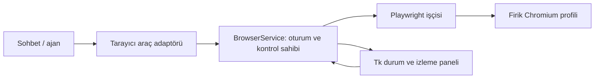

# Firik Browser — entegre tarayıcı önerisi

Tarih: 6 Kasım 2026. Durum: tasarım önerisi; çalışan tarayıcı uygulaması değildir.

## Ürün fikri

Firik, kullanıcının verdiği görev için siteleri açabilsin, sayfaları okuyabilsin,
bağlantılara tıklayabilsin ve formları doldurabilsin. Kullanıcı sohbetin yanında
hangi sitenin açık olduğunu ve ajanın ne yaptığını görebilsin; kontrolü devralıp
geri verebilsin. Hedef, kullanıcının tarif ettiği Codex benzeri birlikte çalışma
deneyimidir; Codex'in iç mimarisi hakkında bir varsayım yapılmaz.

Örnek görevler:

- “Bu kütüphanenin dokümanından örnek bul ve projeye uygula.”
- “Geliştirme sunucusunu aç, dar ekranda menüyü kontrol et.”
- “Bu yönetim panelinde ilgili kayıtları bul ve karşılaştır.”
- “Formu verdiğim bilgilerle doldur ve sonucu göster.”

Her sitenin çalışacağı garanti edilemez. Giriş akışı ve sayfa davranışı hedef
sitelerde doğrulanmalıdır. CAPTCHA ve ikinci doğrulama adımları için kullanıcı
kontrolü devralabilmelidir.

## Bugünkü altyapı

| Parça | Mevcut durum | Yeni özellikteki yeri |
| --- | --- | --- |
| `firik_agent/mcp/web_server.py` | HTTP ile arama ve metin okuma; JavaScript çalıştıran bir tarayıcı değil | Hızlı, herkese açık kaynak okuma |
| `firik_agent/computer_use/` | İşletim sistemi düzeyinde ekran, fare, klavye ve erişilebilirlik araçları | Tarayıcı dışındaki uygulamalar; gerektiğinde açıkça seçilen destek yolu |
| `firik_agent/mcp/manager.py` | MCP araçlarını ajana kaydeder; metin ve görsel sonuçları taşır | Tarayıcı araçları için yeniden kullanılabilir bağlantı |
| `firik_agent/ui/app.py` | CustomTkinter/Tk ana pencere ve olay kuyruğu | Tarayıcı durum/izleme panelinin ekleneceği arayüz |
| `firik_agent/ui/views/chat_view.py` | Sohbet başına MCP seçimi | Tarayıcı erişiminin ilgili sohbetle ilişkilendirilmesi |
| `firik_agent/ui/components/operation_approval.py` | Belirli bir işlem için masaüstü onay bileşeni | Gereken durumlarda tarayıcı işlemleri için uyarlanabilir görünüm |

Mevcut kodda tarayıcıya özel sekme/oturum servisi veya Playwright bağımlılığı yok.
MCP üzerinden araç eklemek, tek başına uygulama içine web sayfası gömmek anlamına
gelmez. Onay bileşeninin bulunması da tarayıcı eylemlerinin zaten denetlendiği
anlamına gelmez; yeni servisle bağlantısı ayrıca kurulmalıdır.

## Hedef arayüz ve akış

Sohbet alanının yanında açılıp kapanabilen Tarayıcı paneli bulunur. Panel sekmeleri,
adres çubuğunu, sayfa görünümünü ve kısa işlem durumunu gösterir. Kontroller:
“Devral”, “Ajana geri ver” ve “Durdur”. Dar pencerede panel ayrı görünüme açılır.

1. Kullanıcı bir görev verir; ajan göreve uygun sayfayı açar.
2. Ajan sayfanın görünür metnini ve etkileşimli öğelerini gözlemler.
3. Buton/alan gibi öğeleri hedefleyerek işlem yapar ve sonucunu yeniden gözlemler.
4. Giriş gerektiğinde kullanıcı devralır; parola ve doğrulama alanları ajanın
   gözleminden çıkarılır. Yeniden başlatma kullanıcı “Ajana geri ver” dediğinde olur.
5. Sonuç, ilgili kaynak veya gözlenen sayfa durumuyla sohbet içinde gösterilir.

Devralma sırasında ajan yeni eylem gönderemez. Önceden alınmış öğe referansları
geçersizleştirilir; geri verildiğinde sayfa yeniden gözlemlenir. “Durdur”, bekleyen
eylemleri iptal eder; sitede zaten gerçekleşmiş bir işlemi geri aldığı iddia edilmez.

## Önerilen teknik yaklaşım

İlk aşamada Python Playwright ve ona uygun Chromium sürümü kullanan bir tarayıcı
işçisi önerilir. Tarayıcı yaşam döngüsünü tek servis yönetir; sohbet ve ileride
eklenecek görünümler aynı servisi kullanır. Araç çağrıları Tk ana döngüsünü bloke
etmez; UI güncellemeleri uygulamanın mevcut olay kuyruğundan geçer.

İlk sürümde Chromium görünür, ayrı bir pencerede çalışır. Firik içindeki panel
sekme/adres/durum ve güncellenen önizlemeyi gösterir. Bu bir **yönetilen tarayıcı**
sürümüdür; önizleme gerçek, gömülü web görünümü olarak sunulmaz. Kullanıcı sayfayla
Chromium penceresinde doğrudan etkileşir.

Tarayıcıyı aynı pencerenin içine gerçekten gömmek ikinci, ayrı bir teslimattır.
Tk içine farklı bir web motorunu eklemek için olay döngüsü, odak, klavye ve
paketleme doğrulanmalıdır. Örneğin pywebview ana iş parçacığında GUI döngüsü
gerektirir; macOS'ta bu özellikle katıdır. Bu nedenle `webview` paketini eklemenin
mevcut Tk panelini otomatik olarak tarayıcıya dönüştüreceği varsayılmamalıdır.
[pywebview FAQ](https://pywebview.flowrl.com/guide/faq.html).

Gerçek gömme aşamasında uygun masaüstü kabuğu/web motoru küçük bir prototiple
seçilir. Prototipin kabul koşulu, **kullanıcının gördüğü sayfa ile ajanın kontrol
ettiği sayfanın aynı oturum ve aynı sayfa olmasıdır**. Bir webview ile ayrıca açılan
Playwright tarayıcısının kendiliğinden aynı sayfayı paylaşacağı varsayılmaz.

## Araçlar ve oturum davranışı

İlk araç kümesi: sekme aç/listele/seç/kapat, sayfaya git, görünür sayfa özeti ve öğe
referansları al, öğeye tıkla, alan doldur, kaydır, tuşa bas, ekran görüntüsü al.
Referanslar sunucu tarafından üretilir ve sayfa değiştiğinde yenilenir; modelin
uydurduğu seçicilerle işlem yapılmaz. Görsel destekleyen modeller için ekran
görüntüsü ek gözlem olabilir; yalnızca metin kullanan modeller de yapılandırılmış
öğe gözlemiyle çalışabilmelidir. Modelin araç çağrısı desteği ayrıca gereklidir.

Firik için ayrı profil dizini kullanılır. Kalıcı profil kullanıcı tarafından
seçilirse giriş durumu sonraki açılışlara taşınabilir; geçici oturum seçeneği de
bulunur. Aynı profil eşzamanlı iki işçiye açılmaz. Playwright kalıcı profilleri
destekler; günlük kullanılan varsayılan Chrome profilini otomasyon profili olarak
kullanmayı desteklemediğini belirtir.
[Playwright BrowserType](https://playwright.dev/python/docs/api/class-browsertype#browser-type-launch-persistent-context).

Tarayıcı erişimi sohbet/görev bağlamına bağlanır. Aynı profili kullanan sohbetlerin
giriş durumunu paylaşabileceği arayüzde anlaşılır olmalıdır. Çerez, token, parola
ve ham profil içeriği araç sonuçlarına konmaz. Giriş sırasında ajan gözlemi ve
görüntü yakalama durur. Sayfa gövdeleri ve görüntüler varsayılan olarak öğrenme
verisine veya kalıcı işlem günlüğüne yazılmaz; normal görev gözlemlerinin model
sağlayıcısına gönderilebildiği ürün akışında açık olmalıdır.

Gezinme ve form hazırlama görev kapsamında ilerler. Gönderim, satın alma veya
silme gibi eylemler kullanıcının mevcut yetkisi ve uygulama politikasıyla
değerlendirilir; her tıklama için tekrar onay istenmez. Yalnızca bir butonun
etiketine bakarak eylemin etkisiz olduğu kabul edilmez. Sonucu belirsiz kalan
işlemler otomatik tekrar edilmeden önce sayfa durumu kontrol edilir.

MCP adaptörü eklenirse mevcut kayıt mekanizmasının `remote_mcp` etiketi gerçek
işçinin konumu ve yetkileriyle ayrıca değerlendirilir. Tarayıcı ayrı bir süreçte
çalışıyor diye işletim sistemi düzeyinde izole edilmiş sayılmaz. Kodlama
oturumlarına erişim de mevcut araç filtresi üzerinden açıkça bağlanmalıdır.

## Teslimat sırası ve doğrulama

| Aşama | Somut sonuç | Kabul kanıtı |
| --- | --- | --- |
| 1. Yönetilen tarayıcı | Görünür Chromium, öğe tabanlı araçlar, ayrı profil, devral/durdur | Yerel test sitesinde sekme, dinamik form ve giriş akışı; devralmada bekleyen çağrının çalışmaması; eski referansın reddi |
| 2. Firik paneli | Sohbet yanında sekmeler, adres, durum, güncellenen önizleme | UI donmadan güncelleme; tarayıcı kapanışı/çökmesi; sohbet değişiminde oturum sahipliği |
| 3. Gerçek gömülü görünüm | Aynı pencere içinde kullanıcı ve ajanın paylaştığı web sayfası | Aynı sayfaya çift yönlü etkileşim; odak/klavye ve giriş; macOS, Windows, Linux paketlerinde doğrulama |
| 4. Görev akışları | Dosya indirme/yükleme ve yerel geliştirme sitesi kontrolü | Hedef dosya/yol doğrulaması; yetkilendirilmiş görev üzerinde sonuç gözlemi |

Playwright ve tarayıcı dosyaları için sürüm uyumlu kurulum/güncelleme ve masaüstü
paketleme ayrıca ele alınır. Geliştirme ortamında çalışması, dağıtılan uygulamanın
da hazır olduğu anlamına gelmez.

Bu öneri hazırlanırken mevcut kaynaklar ve resmi kütüphane belgeleri incelendi.
Tarayıcı kurulmadı veya çalıştırılmadı; yukarıdaki kabul koşulları ilerideki
uygulamanın doğrulama planıdır.
