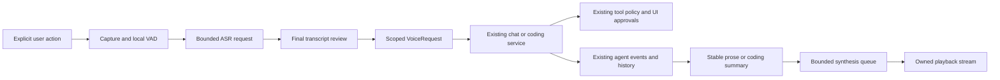

# Voice architecture and capability evidence

This checkpoint covers the desktop voice implementation on 4 November 2026.
Voice submits reviewed text to the existing chat and coding services, preserving
their sessions, context, history, tool policies and operation approvals.

## Reusable modules and boundaries

| Owner | Responsibility and boundary |
| --- | --- |
| [`VoicePanel`](../firik_agent/ui/components/voice_panel.py), `voice_session.py`, `voice_settings.py` | Explicit capture actions, visible state and duration, editable transcript review and independent input, agent and speech controls. UI mutations enter the application dispatcher. |
| [`controller.py`](../firik_agent/voice/controller.py), [`session.py`](../firik_agent/voice/session.py) | State transitions, session generations, cancellation and worker ownership. One application `CaptureCoordinator` shares microphone and playback leases across conversations and diagnostics. |
| [`models.py`](../firik_agent/voice/models.py), [`audio_devices.py`](../firik_agent/voice/audio_devices.py), [`audio_capture.py`](../firik_agent/voice/audio_capture.py) | Immutable PCM values, device identity, optional PortAudio adapter, bounded callbacks and PCM conversion/resampling. `audio.py` preserves compatibility imports. |
| [`vad.py`](../firik_agent/voice/vad.py) | Deterministic energy endpointing and optional WebRTC detection, bounded pre-roll, minimum speech and trailing silence. Synthetic PCM can exercise these independently of hardware. |
| [`transcription.py`](../firik_agent/voice/transcription.py), [`providers.py`](../firik_agent/voice/providers.py), [`api/audio.py`](../firik_agent/api/audio.py), [`api/client.py`](../firik_agent/api/client.py) | WAV validation, sequential segmentation, independent ASR/TTS protocols, response normalization, request limits and safe provider errors. Each utterance shares one ASR HTTP client and request gate. |
| [`requests.py`](../firik_agent/voice/requests.py), [`intent_router.py`](../firik_agent/voice/intent_router.py), [`commands.py`](../firik_agent/voice/commands.py) | Immutable utterance/session/project/workspace scope, exact command parsing, review, duplicate protection and real application destinations. Recognized language remains provider evidence. |
| [`execution.py`](../firik_agent/voice/execution.py), [`ui/service.py`](../firik_agent/ui/service.py), [`ui/coding_bridge.py`](../firik_agent/ui/coding_bridge.py) | Existing chat/coding entry points, scope revalidation and exact-operation UI approvals. Speech cannot approve a tool or override a denied policy. |
| [`synthesis.py`](../firik_agent/voice/synthesis.py), [`playback.py`](../firik_agent/voice/playback.py), [`speech.py`](../firik_agent/voice/speech.py), [`summaries.py`](../firik_agent/voice/summaries.py) | Stable sentence extraction, bounded FIFO, remote or explicit native synthesis, format decoding, cancellable output and concise coding summaries. Native subprocess text travels on stdin. |
| [`config.py`](../firik_agent/voice/config.py), [`diagnostics.py`](../firik_agent/voice/diagnostics.py), [`telemetry.py`](../firik_agent/voice/telemetry.py) | Additive validated preferences, passive setup facts, explicit device tests and safe stage/status/duration measurements. Credentials use the existing endpoint-scoped credential service. |

## Data flow, events and state



`VoiceState` defines disabled, idle, ready, listening, speech-detected,
transcribing, awaiting-confirmation, thinking, executing, speaking, interrupted,
permission-required and error states. Push-to-talk release finalizes capture.
Conversation mode returns from local silent windows to listening after explicit
activation. Successful ASR enters review before the normal submission path.
Cancellation and recoverable failures have explicit transitions in `session.py`.

Native callbacks copy bounded PCM blocks or fill output buffers. Worker threads
perform conversion, VAD, synthesis and playback. The shared async runtime owns
HTTP and agent work. `LatestEvent` coalesces microphone levels before UI dispatch.
Controller generations and speech tickets reject stale deliveries after scope,
settings, provider, page or shutdown changes. Existing `AgentEvent` values carry
agent text, activity, errors and approval decisions through the normal UI path.

Input, agent and speech have separate cancellation owners. Cancelling input
propagates through capture, VAD and pending transcription. Accepted agent work
uses its existing session cancellation. Speech cancellation reaches synthesis,
its HTTP task or native process, and playback. Native stream locks remain held
until the owning worker closes the handle, including during a replacement request.

Microphone PCM/WAV stays in bounded memory through ASR and is released after the
attempt. New recognition requires a new explicit recording. Final reviewed user
text enters normal chat history through submission. Native synthesis uses a
private temporary directory whose context cleans up after success, cancellation
or failure. Remote transcription uploads audio to the configured Evren provider,
and remote synthesis sends response text to that provider.

## Current capability matrix

Read-only verification on 4 November used the public schema and the existing
credential obtained through the application's normal endpoint-scoped lookup.
`GET /openapi.json` and authenticated `GET /v1/models` both returned HTTP 200.
The two audio path definitions and their request schemas equal the vendored
copies. The retrieved full schema SHA-256 was
`5ba9b1b79f0f4ff7cf288ee0e9e7d7ce10eb860bfaf0fbbef9b33680cf6ac8d5`.
[Sanitized discovery record](Evidence/Voice/20261104/provider-discovery.json),
[Public schema](https://evren-llmapi.ssyz.org.tr/openapi.json),
[vendored schema](../firik_agent/api/openapi.json).

| Capability | Verified evidence | Remaining validation |
| --- | --- | --- |
| ASR endpoint and model | Public `POST /v1/audio/transcriptions` schema. Authenticated catalogue declares `qwen3-asr-1.7b` with task `audio_transcription`. | Successful inference, current capacity, account billing and service latency. |
| ASR request construction | Schema declares multipart file/model, optional language/prompt/format/temperature. Mock HTTP tests inspect headers, PCM WAV bytes and automatic versus explicit language. | Real deployment acceptance of a client recording. |
| ASR parsing | Mock JSON, text, SRT, verbose and diarized responses, invalid data, UTF-8 and provider metadata. | Actual response shape/media type, accuracy and Turkish/English recognition quality. |
| TTS endpoint and model | Public `POST /v1/audio/speech` schema. Authenticated catalogue declares `voxcpm2` with task `tts`. | Successful inference, current capacity, account billing and audible quality. |
| TTS options and bytes | Schema advertises WAV, MP3, FLAC, Opus and PCM, speed 0.25–4 and the default voice. Mock HTTP tests cover binary handling, headers, bounds and invalid containers. | Deployment output for each format and optional codec loading on each target platform. |
| Speech languages | ASR accepts an ISO language hint. The client exposes auto, Turkish and English. TTS sends the original UTF-8 text through its documented text input. | Provider language quality and automatic language matching. The TTS schema has no language field. |
| Remote streaming | Schema advertises streamed PCM synthesis. The current adapter requests complete bounded audio and can queue completed sentences. | Incremental remote TTS and partial ASR are outside the current implemented capability. |
| Native local synthesis | Historical 1 November macOS check generated and decoded English/Turkish PCM16 WAV at 22,050 Hz. Native adapters and cleanup have mocked coverage. | Current audible playback, installed Windows voices and Linux synthesis. [Recorded native evidence](Evidence/Voice/20261101/native-synthesis.json). |
| Hardware and packaging | Fake input/output streams exercise refusal, missing/removing devices, queue failure and cleanup. The 4 November macOS arm64 bundle passed ad-hoc signature/metadata checks, frozen PortAudio input/output enumeration and startup/shutdown smoke. | Real microphone consent, physical capture/output, Developer ID distribution and native Windows/Linux packaged execution remain unverified. See [packaging validation](VOICE_PACKAGING.md). |
| Barge-in and wake word | Application half-duplex ownership suppresses microphone capture during playback. Wake word remains disabled and rejected by configuration. | Acoustic echo cancellation, simultaneous production barge-in and wake-word accuracy require explicit backend support and device evidence. |

`SpeechCapabilities.contract_verified` describes the checked-in endpoint contract.
Its authenticated catalogue fields describe the latest explicit GET discovery.
Inference availability, language quality and streaming remain separate facts.
The runtime discovery action checks model access without recording or uploading
audio. Mocked provider and audio API tests pass independently of credentials.
[Provider tests](../tests/test_voice_providers.py),
[audio contract tests](../tests/test_evren_audio_api.py).

## Latency and resource limits

The capture callback queue, pre-roll, utterance duration, transcript size, encoded
and decoded audio, pending sentence count and response text all have client bounds.
One ASR and one TTS operation may run concurrently for a configured endpoint. ASR segments are
sequential and every frame is sent once. Complete boundary planning happens
before the first upload, and only the current segment is encoded for inference.
Native synthesizers and compatible speakers are reused across repeated replies.

Perceived latency includes the configured silence endpoint, completed ASR,
transcript review, agent response and complete synthesis of the first sentence.
The default energy detector can treat sustained background noise as speech.
Optional WebRTC VAD can reduce that sensitivity, with its own deployment checks.
Pure-Python filtering/resampling costs increase with source sample rate. Long
utterances require multiple sequential ASR requests. Complete remote TTS adds
network/client setup for each sentence. OS audio buffers, native device teardown
and the UI dispatch queue also affect when the user hears the first response.

Safe telemetry records VAD endpoint, capture, ASR/request completion, agent
first-token/completion, TTS request/first-audio and voice end-to-end durations.
First-audio playback timing observes the first populated device callback.
End-to-end timing begins at capture completion and includes user review time.
Logs contain stage, status and duration with no transcript, prompt, credentials,
raw audio or endpoint identifiers. These observations support measured tuning.
Live inference timing and physical output latency remain unmeasured here.

## Opt-in provider smoke test

The live test uses the production adapters with a fixed English phrase. It makes
one TTS request, then submits only the returned synthetic WAV to ASR. It checks
binary validation and expected recognized words. Running it requires both the
flag below and an explicitly supplied `FIRIK_LIVE_AUDIO_API_KEY` environment
variable. Its default pytest behavior is to skip even when that variable exists.

```sh
python -m pytest -q --run-live-evren-audio tests/test_evren_audio_live.py
```

This opt-in test can make two potentially billable requests. It uses memory
buffers and requires no microphone or speaker. The current checkpoint verified
the default skip and missing-key refusal using local checks. Live ASR/TTS
inference remains disabled at the user's direction for this checkpoint.
